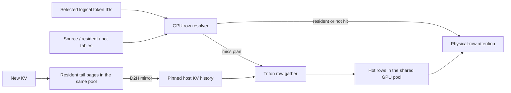
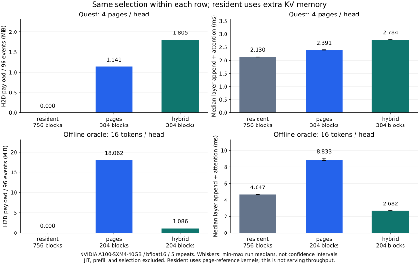

# mini-hisparse

[中文](README.zh-CN.md) · [Visual guide](docs/visual-guide.md) · [Examples](docs/examples.md) · [Benchmarks](docs/benchmarks.md) · [Documentation](docs/README.md)

A small, readable inference engine that keeps decoding when only part of a request's KV cache fits on the GPU. Inspired by vLLM/SGLang HiSparse and the minimal organization of nano-vLLM.

The complete KV history has host backing. Resident pages and reusable hot buffers share **one GPU tensor**. At each decode step, selected logical token IDs resolve to resident rows or hot slots; only missing rows are loaded from pinned host memory. Requests continue without restoring their entire KV history or repeating prefill.

This is an educational systems project with real PyTorch execution and Triton kernels. The pretrained model adapter supports Qwen2/2.5 GQA; the sparse selector is a Quest-style approximation, not a learned DeepSeek DSA indexer.

**Reading path:** [illustrated design](docs/visual-guide.md) → [code walkthrough](docs/code-walkthrough.md) → [runnable examples](docs/examples.md) → [baseline comparisons](docs/benchmarks.md). These tutorials are in Chinese; [Architecture](docs/design.md) and [Validation](docs/validation.md) provide English references.

The [interview answers and assessment](docs/interview.md) connect page states, shared-pool allocation and asynchronous attention to the code, progress conditions and test evidence. The [hot-capacity study](docs/hot-capacity.md) explains why the default `2U` is a tradeoff rather than a minimum or an optimum.

## What is implemented

- **Page ownership and row contents are separate.** The allocator leases blocks; each request/layer manages its hot token rows with tags and LRU replacement.
- **Clean pages remain readable after unpinning.** Resident mappings are revoked only when their physical blocks are actually reused.
- **Proactive hot allocation.** A low-watermark or resident-window trigger requests hot capacity; the last two logical pages remain resident.
- **GPU address resolution.** Deduplication, resident bypass, hit protection, miss planning and row replacement operate on device tensors.
- **Explicit lifetimes.** Events, consumer leases and generations protect asynchronous copies, readers, cancellation and ID reuse.
- **Executable references.** CPU execution, dense oracles, a page-based comparison path, pretrained parity checks and frozen model-trace replay.



## Quick start

Python 3.10+ is required. A CPU is sufficient for the mechanics demo and reference tests.

```bash
git clone https://github.com/KiritoHugh/mini-hisparse.git
cd mini-hisparse
python -m venv .venv
source .venv/bin/activate
python -m pip install --upgrade pip
# CPU setup. For CUDA, install the appropriate CUDA-enabled PyTorch build instead.
python -m pip install torch --index-url https://download.pytorch.org/whl/cpu
python -m pip install -e '.[dev]'

mini-hisparse demo --device cpu --top-k 2 --prompt-tokens 257 --gpu-pages 12
python examples/inspect_indices.py
python scripts/inspect_residency.py --device cpu
```

The demo uses a tiny randomly initialized Transformer and needs no model download. Its token IDs demonstrate execution, not language quality. The output reports per-request prefill/decode counts, resident/hot hits, row misses and memory accounting.

The CUDA path currently targets Linux with an NVIDIA GPU. Install a compatible [CUDA-enabled PyTorch build](https://pytorch.org/get-started/locally/) before installing this package, then run:

```bash
mini-hisparse demo --device cuda:0 --top-k 2 --prompt-tokens 257 --gpu-pages 12
python scripts/inspect_residency.py --device cuda:0
```

The lifecycle script shows **clean → unpinned but readable → block reused → host-row miss** and checks attention outputs against a dense oracle. CUDA validation was performed on an A100; CPU tests do not validate CUDA event ordering or Triton kernels.

## Generate with pretrained weights

```bash
python -m pip install -e '.[models]'
mini-hisparse generate --model Qwen/Qwen2.5-0.5B-Instruct \
  --device cuda:0 --dtype bfloat16 --chat \
  --prompt 'Explain how a KV cache works.' --top-k all --max-new-tokens 32

# Compare greedy generation with Hugging Face after forcibly reclaiming history.
python scripts/validate_pretrained.py --force-host
```

The first run downloads model weights. `--top-k all` uses full attention; `--top-k 4` selects approximately four pages per query head and can change model quality. A page budget is not the same as a token-row budget or the union across heads.

For an application example that reads a local document and computes its host/hot admission budgets:

```bash
python examples/long_context_chat.py --context docs/design.md \
  --question 'Why keep two tail pages resident? Answer briefly.' \
  --device cuda:0 --output results/document-chat.json
```

The [example guide](docs/examples.md) explains truncation, output counters and how to vary the KV budget.

## Capacity and configuration

The default `hybrid` path gives every admitted request/layer a fixed hot-region credit plus two tail blocks:

```text
minimum device blocks per request = layers × (ceil(hot_rows / page_size) + 2)
```

Resident history may borrow unused credits. Hot blocks are physically allocated on transition and stay leased until the request finishes. New requests may wait for admission; admitted requests do not need their full history to become resident again.

| Option | Meaning |
|---|---|
| `--gpu-pages` | Blocks in the shared GPU KV tensor; defaults to one request's minimum footprint |
| `--max-union-rows` | Maximum selected token union per layer/step |
| `--hot-rows` | Hot token slots per request/layer; defaults to twice the union bound |
| `--resident-window-pages` | Hot-allocation trigger, default 64 pages; a configurable simplification, not an attention window or a vLLM constant |
| `--hot-watermark` | Defaults to `max(per-layer hot blocks, GPU blocks // 10)` |
| `--index-budget-mib` | Separate budget for selection summaries and address metadata |
| `--cache-layout pages` | Page-based reference path with bounded-window attention |

`gpu-pages` bounds the persistent KV pool, not total GPU memory. Model weights, indices, activations and prefill workspace are additional. See [architecture](docs/design.md) for indexing and stream dependencies.

## Validation and experiments

```bash
python -m pytest -q
python -m ruff check mini_hisparse reference experiments scripts examples tests
python -m ruff format --check mini_hisparse reference experiments scripts examples tests

# Optional: download a pinned LongBench sample and capture a real model trace.
python scripts/prepare_longbench.py
python scripts/model_trace.py capture --max-context 1024 --steps 8
python scripts/model_trace.py analyze
python scripts/replay_trace.py
```

The recorded A100 validation has **96 passing tests**, including continued append/attention at the minimum hot/tail footprint when every selected historical row misses. A 32-token Qwen2.5 greedy-generation check matches Hugging Face (`prefill_count=1`), and real model-trace replay checks 96 layer events per run against the same-selection oracle. [Validation](docs/validation.md) identifies configurations, raw reports and measurement limits. GitHub CI runs CPU checks; GPU checks are run separately.

Raw datasets, weights and tensor traces are not included. Trace results use frozen dense-teacher activations with explicit sparse selection; they are not native DSA traces, end-to-end LongBench scores or serving-throughput measurements.

## Baseline comparisons



Five repeats on an A100, 96 frozen Qwen layer events, current two-tail runtime. Within each selection workload, `pages` and `hybrid` have identical GPU KV capacity; `resident` uses extra memory and the page-reference attention backend. It is a no-reload control, not an optimized latency bound.

The result depends on access shape: hybrid transfers **more** data for Quest page selections, while dispersed offline-oracle token selections benefit from row loading. The [benchmark report](docs/benchmarks.md) includes raw JSON, memory/index budgets, numerical errors, timing boundaries and reproduction commands. These are storage-path experiments, not serving speedup claims.

## Reading the code

The runtime package contains only the hybrid execution path. `HybridKVCache`
composes a `HostStore` and `DeviceAllocator`; it does not inherit from the
page-based reference. `model.decode()` calls `cache.attention()` directly.

```text
mini_hisparse/   hybrid runtime, storage, row resolver/kernels, model and engine
reference/      optional page replacement and bounded-window attention
experiments/    benchmark, model trace capture/analysis and replay
scripts/        runnable experiment and validation entry points
examples/       address translation and a local-document Qwen application
tests/          runtime, reference and dependency-boundary checks
```

The default CLI runs without importing `reference` or `experiments`. Those
packages are loaded only for explicit comparison/benchmark commands and are
included in the distribution. See [the refactor and API migration](docs/refactor.md).


| File | Responsibility |
|---|---|
| [hybrid.py](mini_hisparse/hybrid.py) | Residency policy, hot block leases, two-page tails and row lifetimes |
| [allocator.py](mini_hisparse/allocator.py) | Shared storage, ownership, readable-unpinned blocks and generations |
| [row_index.py](mini_hisparse/row_index.py) | Logical-to-physical translation, tags, hit protection and row LRU |
| [row_kernels.py](mini_hisparse/row_kernels.py) | Triton pinned-host gather and physical-row GQA attention |
| [storage.py](mini_hisparse/storage.py) | Host backing, page metadata, mirror events and deferred retirement |
| [model.py](mini_hisparse/model.py) / [engine.py](mini_hisparse/engine.py) | Transformer execution and request scheduling |
| [selection.py](mini_hisparse/selection.py) | Exact selection masks, Quest-style scoring and dense oracles |
| [reference/](reference/) / [experiments/](experiments/) | Optional page-cache comparison and offline experiments |

## Scope

The project is single-process, single-GPU and executes requests sequentially. It does not implement production batching, chunked prefill, MLA/FP8, tensor parallelism, prefix sharing/COW or shared-index cross-layer prefetch. The row resolver uses multiple PyTorch kernels; only the resolver has a CUDA Graph capture test. Host row gathering is SM-initiated access, not copy-engine DMA. Under exhausted capacity, the teaching runner may wait for a relevant D2H event.

[vLLM alignment](docs/hybrid-alignment.md) and [residency alignment](docs/residency-alignment.md) document exactly which mechanisms match the pinned upstream snapshot and which remain simplified.

## Contributing and references

See [CONTRIBUTING.md](CONTRIBUTING.md) for development and validation. Design references include [vLLM](https://github.com/vllm-project/vllm), [SGLang](https://github.com/sgl-project/sglang), [nano-vLLM](https://github.com/GeeeekExplorer/nano-vllm) and [Quest](https://github.com/mit-han-lab/Quest). [Source notes](docs/upstream.md) pin the revisions inspected; no upstream implementation is vendored or required at runtime.

Licensed under [MIT](LICENSE).
