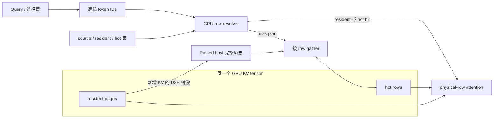
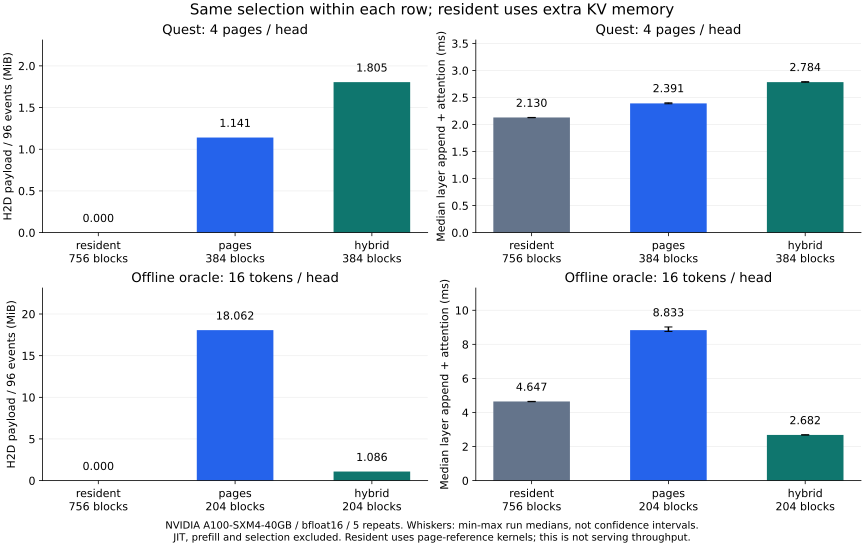

# mini-hisparse

[English](README.md) · [图解设计](docs/visual-guide.md) · [运行例子](docs/examples.md) · [测评对比](docs/benchmarks.md) · [文档导航](docs/README.md)

一个可在单卡上运行、便于阅读的 KV Cache 分层解码引擎。它回答的问题是：**请求的一部分 KV 页已被逐出 GPU，怎样继续 decode，而不重新 prefill？**

完整历史保留 host backing；resident pages 与 hot buffers 共享一个 GPU tensor。每步把选中的逻辑 token 解析为 resident row 或 hot slot，只从 host 加载缺失 rows。请求无需恢复全部 KV，仍能继续生成。

**独立面试答卷：[在线设计文档](docs/partial-residency-design.md) · [PDF 版本](docs/partial-residency-design.pdf)。** 自成体系说明约束、页面管理、共享池分配、解码时序与效率优化，以同一容量示例串联七张图和短伪代码。

项目借鉴 nano-vLLM 的小型引擎组织方式，参考 vLLM / SGLang HiSparse 的生命周期与搬运设计。默认 runtime 只有 hybrid 一条路径，页级实现位于独立 `reference/`，用于显式 baseline 对比。预训练适配支持 Qwen2/2.5 GQA；Quest 是近似选择器，不是 DeepSeek learned DSA indexer。

## 先看图，再跑代码

| 想了解什么 | 从这里开始 |
|---|---|
| page、block、row、hot slot 有何区别？ | [图解设计](docs/visual-guide.md)：具体地址计算、clean 回收、两页 tail、hot 分配、stream 时序 |
| 一步 decode 实际调用了什么？ | [代码调用链](docs/code-walkthrough.md)：Engine → Model → Cache → Resolver → Kernel |
| 如何演示或接入应用？ | [可运行例子](docs/examples.md)：索引检查、小池多请求、真实文档问答 |
| 相比 baseline 有什么收益和代价？ | [当前测评](docs/benchmarks.md)：全驻留 / 页缓存 / hybrid，原始数据和复现命令 |
| 与 vLLM 对齐到哪里？ | [索引与 hot 对齐](docs/hybrid-alignment.md)、[驻留生命周期对齐](docs/residency-alignment.md) |
| 如何回答面试追问？ | [三问详答、进展条件与改进评估](docs/interview.md) |
| Hot 为什么默认 2U，能不能更小？ | [固定总容量的敏感性实验](docs/hot-capacity.md) |



## 快速运行

Python ≥ 3.10。无需模型下载的 CPU 演示：

```bash
git clone https://github.com/KiritoHugh/mini-hisparse.git
cd mini-hisparse
python -m venv .venv
source .venv/bin/activate
python -m pip install --upgrade pip
python -m pip install torch --index-url https://download.pytorch.org/whl/cpu
python -m pip install -e '.[dev]'

# 手算与真实 resolver 对照：resident hit、hot hit、miss 和重复输入
python examples/inspect_indices.py
# clean → unpin 后仍可读 → block 真正复用 → host-row miss
python scripts/inspect_residency.py --device cpu
# 三请求竞争小 KV 池，每个请求只做一次 prefill
mini-hisparse demo --device cpu --top-k 2 --prompt-tokens 257 --gpu-pages 12
```

Tiny demo 使用随机 Transformer 权重，展示执行机制，token IDs 不代表语言能力。输出包括请求计数、准入 timeline、resident/hot hits、misses 和内存统计。

CUDA 路径面向 Linux / NVIDIA GPU：先按 [PyTorch 官方安装说明](https://pytorch.org/get-started/locally/) 安装兼容的 CUDA PyTorch，再把 `--device cpu` 换为 `--device cuda:0`。当前实测硬件为 A100；CPU 检查不能验证 CUDA 事件与 Triton kernel。

## 用真实模型询问文档

```bash
python -m pip install -e '.[models]'
python examples/long_context_chat.py --context docs/design.md \
  --question 'Why keep two tail pages resident? Answer briefly.' \
  --context-tokens 1024 --max-new-tokens 32 --top-k 4 \
  --device cuda:0 --output results/document-chat.json

# 完整选择生成；首次下载 Qwen 权重，也可传本地模型目录
mini-hisparse generate --model Qwen/Qwen2.5-0.5B-Instruct --chat \
  --prompt '用三句话解释 KV Cache。' --device cuda:0 --dtype bfloat16 \
  --top-k all --max-new-tokens 32
```

文档例子自动计算 host/hot 配额，并明确记录 head+tail 截断。`--top-k 4` 是每 query head 的近似页预算，可能改变模型质量；`--top-k all` 是完整选择，需要更大的 hot 配额。当前仅支持标准 RoPE、非 sliding-window 的 Qwen2/2.5。详见 [使用例子与结果解读](docs/examples.md)。

## 容量规则

```text
每请求最低 device blocks = layers × (ceil(hot_rows / page_size) + 2)
```

Hot rows 默认是单步选择并集上界的两倍，必须至少覆盖该并集。准入先预留 credit，resident history 可借用未使用空间；压力触发后实际分配 hot blocks，内部 rows 按 LRU 替换。

| 参数 / 状态 | 含义 |
|---|---|
| `--gpu-pages` | 唯一持久 GPU KV tensor 的 block 数；默认取一请求最低配额 |
| `--max-union-rows` / `--hot-rows` | 跨头选择并集上界 / 每请求每层 hot token slots |
| `--resident-window-pages` | 默认 64，是 hot 申请阈值，不是 attention window，也不是 vLLM 固定默认值 |
| `--hot-watermark` | 默认 `max(每层 hot blocks, 总 blocks // 10)` |
| clean unpinned | 容量可回收，内容仍可读；真正复用 block 才撤销映射 |
| 两页 tail | 每层最后两个逻辑页保持 resident |
| `--cache-layout pages` | 显式运行独立的页级分窗参考实现 |

GPU KV 配额不包括权重、索引、activations 和 prefill workspace。Host 与索引有独立预算；新请求可能等待准入，已准入请求的历史被回收不要求重做 prefill。[分配与生命周期图解](docs/visual-guide.md)。

## 当前测评



同一组真实 Qwen 激活，在 A100 上每配置重复五次。`pages` 与 `hybrid` 使用相同 KV block 数；`resident` 用额外空间容纳完整历史，沿用页参考 attention，是零 reload 对照。

Quest 整页选择下，hybrid 多搬数据且更慢；离线 oracle 分散 token 选择下，hybrid 减少了搬运与层级耗时。这个取舍是项目要展示的内容。完整 [测评文档](docs/benchmarks.md) 给出配置、索引成本、数值误差、原始 JSON、计时范围及复现命令。它不是原生 DSA、LongBench 任务得分或服务 tokens/s 的结论。

## 代码与验证

```text
mini_hisparse/   默认 hybrid runtime：配置、存储、row resolver/kernel、模型与引擎
reference/      独立页缓存与分窗 attention，只在显式选择时导入
experiments/    真实模型 trace、回放与 benchmark
examples/       索引示例与本地文档问答应用
scripts/        验证、采集、比较和绘图入口
tests/          数值、生命周期、资源与依赖边界测试
docs/           图解教程、设计参考、测评和历史记录
```

`HybridKVCache` 组合 `HostStore` 与 `DeviceAllocator`，不继承旧页缓存。默认 `model.decode()` 直接调用 `cache.attention()`。[代码阅读路线](docs/code-walkthrough.md) 和 [0.2 API 迁移](docs/refactor.md) 说明职责边界。

已记录 A100 **96 项测试通过**，包括最低 hot/tail 配额下每步全 miss 仍持续追加和 attention。强制回收合格历史页后，Qwen2.5 的 32 个生成 token 与 Hugging Face 完全一致，prefill 只有一次。当前比较的每个 trace event 均通过相同 selection 的数值校验。[验证证据](docs/validation.md)。GitHub CI 检查 CPU 路径，GPU 另行验证。

```bash
python -m pytest -q
python -m ruff check mini_hisparse reference experiments scripts examples tests
python -m ruff format --check mini_hisparse reference experiments scripts examples tests
```

本项目是单进程、单卡、串行教学引擎；未实现生产 batching、MLA/FP8、TP、prefix sharing 或跨层共享 index 预取。Resolver 是多个 Torch device 算子，只有独立 resolver 做了 Graph 测试；SM host gather 也不等于 DMA copy。完整 [实现边界](docs/design.md#implementation-boundaries) 与 [上游源码参考](docs/upstream.md) 可供核对。

贡献方式见 [CONTRIBUTING.md](CONTRIBUTING.md)。[MIT 许可证](LICENSE)；上游项目保留各自许可证与归属。
