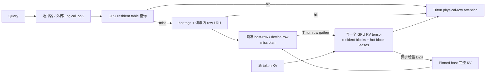

# mini-hisparse

[English](README.md) · [架构](docs/design.md) · [验证结果](docs/validation.md) · [文档目录](docs/README.md)

一个代码可读、可以在单卡上运行的 KV Cache 分层解码引擎，用于学习和演示部分驻留下的持续解码。

**核心问题：请求的部分 KV 页已被逐出 GPU，它还能继续 decode 吗？** 可以：保留逻辑页身份和 host backing，为请求分配有界的 hot block 租约，只把选中的缺失 KV token rows 放回其中。GPU 不需要重新容纳整个请求，也不需要重新 prefill。

项目借鉴 nano-vLLM 的小型引擎组织方式，阅读并参考 vLLM / SGLang HiSparse 的生命周期与搬运设计，独立实现可读的单进程版本。源码与 commit 对照见 [源码阅读笔记](docs/upstream.md)。

`demo/generate/replay_trace` 默认 `--cache-layout hybrid`：block 租约与 row 内容分离，GPU 上进行地址解析与 row LRU，Triton 按 miss row 搬运。页级分窗参考路径通过 `--cache-layout pages` 保留。Quest 是可替换的选择器，不是 learned DSA indexer。[vLLM 对齐说明](docs/hybrid-alignment.md) 列出了具体机制与实现边界。

[Clean page、hot 触发与两页 tail](docs/residency-alignment.md)：clean 历史页先变为“可回收但仍可读”，实际复用 block 时才撤销映射；hot 按低水位或 resident window 提前申请，每层保留最后两个逻辑页。

## 运行

Python ≥ 3.10，PyTorch ≥ 2.5。CUDA 路径使用随 CUDA PyTorch 安装的 Triton；CPU 路径可验证缓存语义，但不能替代 CUDA 时序和 kernel 检查。

```bash
git clone https://github.com/KiritoHugh/mini-hisparse.git
cd mini-hisparse
python -m venv .venv
source .venv/bin/activate
python -m pip install --upgrade pip
# 先安装适合本机的 PyTorch；仅 CPU 可使用以下命令
python -m pip install torch --index-url https://download.pytorch.org/whl/cpu
python -m pip install -e '.[dev,models]'

# 无需模型下载：真实 Transformer forward；随机权重仅演示机制
.venv/bin/python -m mini_hisparse demo --device cpu \
  --top-k 2 --prompt-tokens 257 --gpu-pages 12

# 显示 unpin 后仍可读、实际复用后才出现 host miss 的完整过程
.venv/bin/python scripts/inspect_residency.py --device cpu

# 安装 CUDA 版 PyTorch 后可在 GPU 上运行
.venv/bin/python -m mini_hisparse demo --device cuda:0 --top-k 2 --prompt-tokens 257

# 页级参考模式：极小池、整个 selection 大于池、在线 softmax 分窗
.venv/bin/python -m mini_hisparse demo --device cpu --cache-layout pages --gpu-pages 1

# CPU、CUDA、Triton、随机逐出与端到端输出一致性测试
.venv/bin/python -m pytest -q
```

当前 CUDA 路径面向 Linux / NVIDIA GPU；CUDA 轮子应与本机驱动匹配，参照 [PyTorch 官方安装说明](https://pytorch.org/get-started/locally/) 选择版本。项目已在 NVIDIA A100 上验证。

输出包含 `prefill_count/decode_count`、逻辑页位置、hot block 数和 `row_stats`（resident/hot row hits、misses、H2D bytes），并分别报告 empty、readable-unpinned、allocatable blocks。新请求可能等待 hot 配额；每层准入需 `ceil(hot_rows/page_size)+2` blocks。`--top-k` 以选择器的页预算计数，`--max-union-rows/--hot-rows` 以 token rows 计数。`--resident-window-pages` 默认 64，仅是可配置的 hot 申请阈值，不是 attention window 或 vLLM 固定默认值；`--hot-watermark` 未指定时为 `max(本层 hot blocks, GPU blocks // 10)`。

## 用真实权重生成文本

```bash
.venv/bin/python -m mini_hisparse generate \
  --model Qwen/Qwen2.5-0.5B-Instruct --chat \
  --prompt '用三句话解释 KV Cache。' \
  --device cuda:0 --dtype bfloat16 \
  --top-k all --max-new-tokens 64
```

也可以传本地模型目录。仅支持标准 RoPE、非 sliding-window 的 Qwen2/Qwen2.5。首次使用远端模型会下载权重。默认 `--top-k all` 保持全量 causal attention；`--top-k 4` 则切换到 **近似页级稀疏 attention**，可能改变文本质量。

随机小模型的作用是离线验证，不能用于展示语言能力。Quest 风格 min/max indexer 与 `--selector mean` 对照方案 **都不是 DeepSeek 的 learned DSA indexer**。缓存搬运在同一 selection 下应保持数值一致，不等于对稠密模型做 top-k 后还能保证精度不变。精确 token selection 接口可以回放原生 indexer 导出的 token ID，当前没有声称已采集原生 DSA 权重的真实轨迹。

可选的真实权重对照（与 Hugging Face greedy generation 比较）：

```bash
.venv/bin/python scripts/validate_pretrained.py --force-host
```

如果网络环境使用 SOCKS 代理，可在环境里另外安装 `socksio`。`requirements-tested.txt` 记录本机验证时的完整依赖版本，包含 CUDA 13.2 的 Linux 轮子；它是实验记录，不是所有机器通用的安装要求。

## 结构

```text
mini_hisparse/
  hybrid.py      默认 hybrid 路径：hot block 租约、resident/tail、row 生命周期
  row_index.py   LogicalTopK、GPU 地址翻译、hot tags/LRU、紧凑 miss plan
  row_kernels.py Triton pinned-host row gather、直接读取物理 row 的 attention
  cache.py       逻辑页表、唯一 GPU KV tensor、pinned host pool、租约和事件
  allocator.py   物理槽 owner/generation、空闲与可读回收队列、页级参考策略
  selection.py   每头精确 token mask、Quest min/max、离线选择质量 oracle
  attention.py   页选择、双窗口流水、在线 softmax 合并、PyTorch oracle
  kernels.py     Triton paged attention：直接读取物理槽位，不 gather 整个 KV
  model.py       小型 Qwen2 结构、prefill/decode、可选预训练权重适配
  engine.py      host/index/hot 容量准入、轮转调度、请求结束回收
  benchmark.py   resident / serial offload / overlap 三组固定访问轨迹实验
  traces.py      真实模型激活采集、来源校验、选择质量与复用统计
  replay.py      固定真实轨迹的缓存策略回放
  cli.py         demo / generate / bench
tests/           数值、生命周期、竞态和端到端验证
docs/            设计、源码对照、面试讲解、实测记录
```



## 对照实验

```bash
.venv/bin/python -m mini_hisparse bench \
  --device cuda:0 --tokens 1024 --steps 20 --requests 3 \
  --gpu-pages 8 --selected-pages 8 --chunk-pages 2 \
  --output results/benchmark.json

# 单独采集 trace；profiler 会影响计时，不能直接拿其时间做性能结论
.venv/bin/python -m mini_hisparse bench \
  --device cuda:0 --steps 5 --gpu-pages 8 \
  --trace results/overlap.json --output results/profiled.json
```

计时包含新 KV 追加和固定 selection 的 attention，不包含 oracle、模型投影、tokenizer 或网络服务。报告的是 KV 微基准，**不是 LLM tokens/s**。所有模式使用相同数据与选择集合，计时后逐项核对 CPU oracle。

详见 [架构与正确性](docs/page-cache.md)、[面试讲解路线](docs/interview.md) 和 [实测记录](docs/history/initial-validation.md)。

## 真实文本、top-k 轨迹与空间策略对照

```bash
# 下载固定版本官方 LongBench，只取三类任务各一个确定样本
.venv/bin/python scripts/prepare_longbench.py
# 真实预训练模型、约 1K context、4 个采样层、每请求 8 步
.venv/bin/python scripts/model_trace.py capture
.venv/bin/python scripts/model_trace.py analyze --budget 4
# 同一份 Q/K/V 和选择，改变 GPU 容量与逐出策略；不重新采样 top-k
.venv/bin/python scripts/compare_policies.py --capacities 32 128 256
# 同一 trace、selection、GPU block 数，对照页级与 hybrid row 存储
.venv/bin/python scripts/compare_layouts.py --selector quest --budget 4
.venv/bin/python scripts/compare_layouts.py --selector oracle_token --budget 1 \
  --output results/token-layout-comparison.json
# 默认 hybrid 回放，根据 trace 的最大 token union 计算固定准入下限
.venv/bin/python scripts/replay_trace.py
```

数据与完整 tensor trace 放在忽略版本控制的 `results/`，小型统计报告在 `docs/`。报告分别给出 attention mass、稀疏输出误差、token Jaccard、每头预算与页面并集放大，以及缓存搬运误差和 H2D bytes。冻结 dense teacher 轨迹用于公平的缓存实验；它不包含稀疏生成反过来改变未来 query 的反馈，不能当作 LongBench 任务得分。

页级参考路径的 `--eviction-policy legacy|lru|fair_lru` 可切换策略；hybrid 使用独立的 resident 回收和请求/层内 row LRU。`--index-budget-mib` 同时约束摘要与 hybrid 常驻索引表。host 容量以 credit 预留，物理映射在首次写入时建立；完成和取消通过延迟回收归还 host 页和索引。`oracle_token` 是离线选择质量对照，绝不能当成真实 DSA indexer。

## 实现边界

- GPU KV 主存只有一个固定 tensor；索引摘要有独立准入预算，权重、activation 和 attention 临时空间仍需要另计总显存。mean 元数据用 FP32，min/max 保留 KV 原始 dtype。
- Resident 和 hot 租约共享一个 slab；水位或窗口触发持久 hot demand，整组 blocks 分配成功后，clean 历史页才解除 allocation pin。它们仍可命中，直到实际复用；最后两页始终保留。
- Hybrid 要求 hot 容量覆盖配置的单步 union，准入不满足时新请求等待。一个槽位分窗前进只属于 `pages` 参考模式。
- GPU resolver 使用多个 PyTorch 算子，已验证其 CUDA Graph capture/replay；整个引擎尚未 graph capture。Quest→Selection 适配仍有 CPU 往返，直接传 GPU `LogicalTopK` 可绕过该适配。
- Host gather 从 pinned 内存直接读入缺失 row，属于 SM copy，不能将其描述为 copy engine DMA。并未实现共享 indexer 的跨层预取。
- 单线程控制面、单卡、逐请求执行；没有真正的批处理、TP、speculative decoding、prefix sharing、RDMA 或服务接口。
- 初次 prefill 使用常规 SDPA，存在每层 prompt K/V 临时张量；限制的是 decode 持久 KV 池，不能把它解读为端到端峰值显存上界。
- `reclaim_history()` 默认仅 unpin 已完成镜像的历史页；`evict=True` 是额外撤销映射的诊断选项。hot block 租约存活期间不支持 `set_budget()` 改变总配额。实际分配耗尽时可能等待单个 D2H 完成事件；常规 policy tick 只非阻塞查询事件。

## 验证与贡献

已记录的 A100 验证为 **93 项测试通过**；真实 Qwen2.5 强制回收历史页后，32 个生成 token 与 Hugging Face 完全一致，prefill 只有一次。96 个真实模型 trace 事件通过相同 selection 的数值对照。配置、原始报告和测量边界见 [验证结果](docs/validation.md)。GitHub CI 运行 CPU 检查，CUDA 正确性需另外验证。

开发与检查方式见 [CONTRIBUTING.md](CONTRIBUTING.md)。历史评审记录和旧版报告见 [文档目录](docs/README.md)。项目采用 [MIT 许可证](LICENSE)，上游项目保留各自的许可证与归属。
