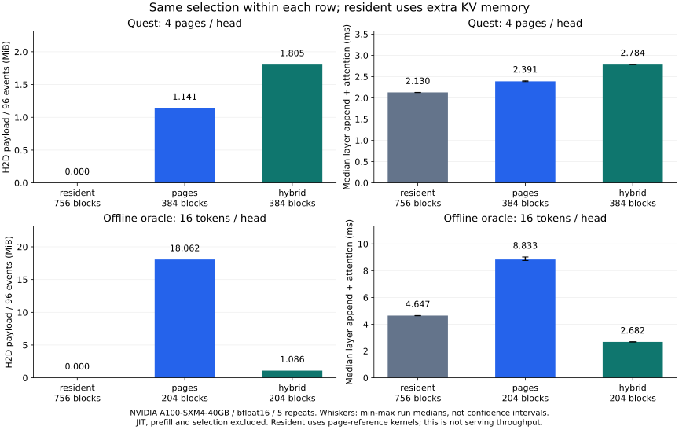
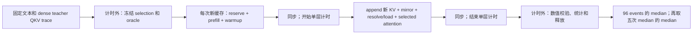

# 当前版本：baseline、测量方法与结果

[文档首页](README.md) · 前置：[运行例子](examples.md) · [正确性验证](validation.md) · [trace 格式与局限](traces.md)

**Row cache 的收益取决于选中 token 的分布。** 本次 A100 测量中，Quest 整页选择下 hybrid 比页级缓存多搬数据、耗时更高；分散 token 选择下，hybrid 明显降低搬运量和层级回放耗时。两组选择预算不同，应在各自组内比较存储布局，不能把它们相互比较为“模型加速”。

进一步追问“hot 留多少”可看 [固定总容量的 hot sweep](hot-capacity.md)：比较 1U / 1.5U / 2U，同时固定触发阈值，并标出不可准入配置。三道面试问题的实现、证据和剩余边界汇总在 [interview.md](interview.md)。



图由 [plot_comparison.py](../scripts/plot_comparison.py) 直接读取原始 JSON 生成。误差线表示五次 run median 的最小/最大值，不是置信区间。

## 三个 baseline 分别代表什么？

| 配置 | GPU KV 容量 | attention / 缓存方式 | 回答的问题 |
|---|---|---|---|
| `resident` | 756 blocks，足够全历史 | `reference.PagedKVCache`，同样稀疏 mask，零 reload | 这个参考实现如果无需 H2D 会怎样？ |
| `pages` | 与 hybrid 完全相同 | 整页搬运、fair LRU、4-page 分窗 attention，可流水预取 | 在相同 KV 配额下，整页与按 row 的取舍 |
| `hybrid` | 按当前两页 tail 准入下限 | 固定 hot block lease + row LRU + row attention | 有界 hot 空间能否减少 miss 数据量与耗时？ |

`resident` 仍使用参考路径的分窗 attention，不是 full/dense attention，也不是优化后的全驻留性能下界。Hybrid 比这个 resident 对照快，并不能证明比所有全驻留 attention 都快。`pages` 与 `hybrid` 的 attention kernels、元数据和策略都不同，所以时间差是**完整缓存路径的差异**，不是单独 row gather kernel 的加速比。

同 GPU KV 配额不等于同总显存：另有常驻索引、激活、临时算子空间。以下同时报告索引字节数，未测总 HBM 峰值。

## 数据与实验条件

| 项目 | 本次设置 |
|---|---|
| Runtime | `17ef5a723e52b6aebfae9f2614d9af4309b824e7`，0.2 组合式存储实现，两页 tail |
| 设备 | 单张 NVIDIA A100-SXM4-40GB，`cuda:0` |
| 环境 | Python 3.11，PyTorch 2.15.0+cu132，BF16；其余见 [依赖快照](../requirements-tested.txt) |
| 模型激活 | Qwen2.5-0.5B-Instruct，post-RoPE Q/K/V，GQA：14 query heads / 2 KV heads / head dim 64 |
| 数据 | LongBench qasper:163、gov_report:163、repobench-p:327；dataset revision `5e628be450b7e67fb7ae6e201bd6d8f7056f7672` |
| 长度 | 1024 context 上限；chat 模板和裁剪后，各 prompt 实际为 988 tokens |
| 回放规模 | 3 请求 × 4 采样层（2/7/15/23）× 8 decode steps = 96 layer events |
| 存储 | page size 16；每 KV row 512 bytes，每 block 8192 bytes；12 个 request/layer groups |
| 重复 | 每配置 5 次，轮换三种配置运行顺序，每次创建新缓存 |

原始 trace 的 SHA256、命令、comparison script SHA256、运行顺序和逐次结果保存在 [Quest JSON](reports/layout-quest.json) / [token JSON](reports/layout-token.json)。公开报告保留来源行号、文本/prompt hash 和长度，不附 prompt token IDs 或完整 tensor trace。

现有采集 trace 的 `model_revision` 为 `null`，无法仅凭报告锁定 Hugging Face 权重 commit；trace hash 能标识本次固定输入，但重新下载模型采集不保证字节一致。三个样本都做了 head+tail 截断，不能称为完整长上下文任务评测。

## 实验 A：Quest，每头 4 页

不同头可选不同历史页，sink/tail 共享。最大单步 token 并集 `U=239`，平均 154.67；`hot_rows=478`，每层 `ceil(478/16)=30` hot blocks。12 groups 的最低配额为 `12*(30+2)=384 blocks`。

| 布局 | KV blocks / MiB | Index KiB | H2D MiB / 96 events | Median ms / layer step | 最大存储 abs error |
|---|---:|---:|---:|---:|---:|
| resident | 756 / 5.906 | 756.0 | 0 | 2.130 | 0.001953125 |
| pages | 384 / 3.000 | 756.0 | 1.141 | 2.391 | 0.001953125 |
| hybrid | 384 / 3.000 | 830.5 | 1.805 | 2.784 | 0.001953125 |

**观察：** 相同 KV 配额下 hybrid 多搬约 58.2% 的 H2D payload，层级 median 耗时约增加 16.4%。整页选择本身已经具有页内局部性；固定 hot lease 占用原可留给 resident history 的空间，同时 row resolver 有额外开销。这是与观测一致的机制解释，尚未做逐项成本消融来分离每个因素。

## 实验 B：离线 oracle，每头 16 tokens

`--selector oracle_token --budget 1` 在真实 QK score 上每头取 `1*16` tokens。它需要读取完整 K 来选 token，**不是免费在线 indexer，也不是原生 DSA trace**。这个实验用来构造真实激活上的分散 token 访问。

最大 union `U=116`，平均 70.27；`hot_rows=232`，最低配额 `12*(ceil(232/16)+2)=204 blocks`。

| 布局 | KV blocks / MiB | Index KiB | H2D MiB / 96 events | Median ms / layer step | 最大存储 abs error |
|---|---:|---:|---:|---:|---:|
| resident | 756 / 5.906 | 756.0 | 0 | 4.647 | 0.00048828125 |
| pages | 204 / 1.594 | 756.0 | 18.062 | 8.833 | 0.00048828125 |
| hybrid | 204 / 1.594 | 795.2 | 1.086 | 2.682 | 0.0078125 |

**观察：** 相同 KV 配额下 hybrid 的 H2D payload 减少约 94.0%，层级回放约为页参考的 3.29 倍速度。本组 hybrid 有 2,225 个 row misses，乘以 512 bytes 正好是 1,139,200 bytes。Page reference 则为零散 token 搬整页，并执行更多分窗计算。

这个优势不能外推到 vLLM/SGLang 吞吐，也不包括 oracle 选择成本。数值检验使用相同 selection 的直接 attention oracle；BF16 `atol=rtol=0.008`，全部 events 通过，不要求 bitwise 一致。

## 计时包含什么？



- **包含：** Python 控制、append/摘要更新、新 KV 镜像、地址解析/加载、attention，以及完成同步。Hybrid 的 `Selection → LogicalTopK` 适配也在路径内。
- **排除：** 文本 tokenization、模型投影/MLP、prefill、selection/oracle 准备、Triton 编译预热和数值比较。Profiler 未开启。
- **Warmup：** prefill 后在第一个 request/layer 做最多四页 attention；hybrid 另用无效 row 编译实测形状。随后同步并清零 counters。这是部分预热的 decode replay，不是冷启动测量。
- **H2D：** 统计这 96 events 的有效 KV payload 字节数，不包含 prefill/warmup，不是 PCIe 链路实际事务字节。三种配置均另有 49,152 bytes 的新增 KV D2H 镜像。
- **时间：** 每个 layer event 前后同步，因此不是批量 serving 吞吐、完整 token latency，也不能证明跨层 overlap。

全层/多请求 admission 在回放开始前完成。使用 trace 已知的最大 union 配置 hot 是离线实验设定；在线示例使用根据选择器推导的上界，不能假设未来 trace 已知。

## 如何复现？

在仓库根目录，安装对应 CUDA PyTorch 和项目 extras；首次需下载模型与公开数据：

```bash
python -m pip install -e '.[dev,models,plots]'
python scripts/prepare_longbench.py
python scripts/model_trace.py capture --max-context 1024 --steps 8

python scripts/compare_layouts.py --include-resident --selector quest \
  --budget 4 --repeats 5 --output results/layout-quest.json
python scripts/compare_layouts.py --include-resident --selector oracle_token \
  --budget 1 --repeats 5 --output results/layout-token.json

python scripts/plot_comparison.py --quest results/layout-quest.json \
  --token results/layout-token.json --output results/layout-comparison.svg
```

只重新生成仓库已有报告的图，不需要 GPU、模型或 trace：

```bash
python -m pip install -e '.[plots]'
python scripts/plot_comparison.py
```

## 这些实验没有回答什么？

存储误差比较的是 **同 selection**；它没有衡量丢弃未选 token 造成的模型质量变化。`model_trace.py analyze --budget 4` 可另看 attention mass、relative output L2、token recall 和时间复用，但那些只是逐层代理指标。固定 dense teacher 轨迹也没有 sparse 输出对未来 Q/K/V 的反馈。

目前没有原生 learned DSA/MLA trace、LongBench 最终任务得分、真实服务并发吞吐或跨硬件扩展结果。若要声称端到端加速，需要补上选择器成本、完整模型生成、足量样本/输出长度与质量对照。早期单 tail 报告仍保存在历史资料中，不与当前两个 tail 的容量或耗时混用。
