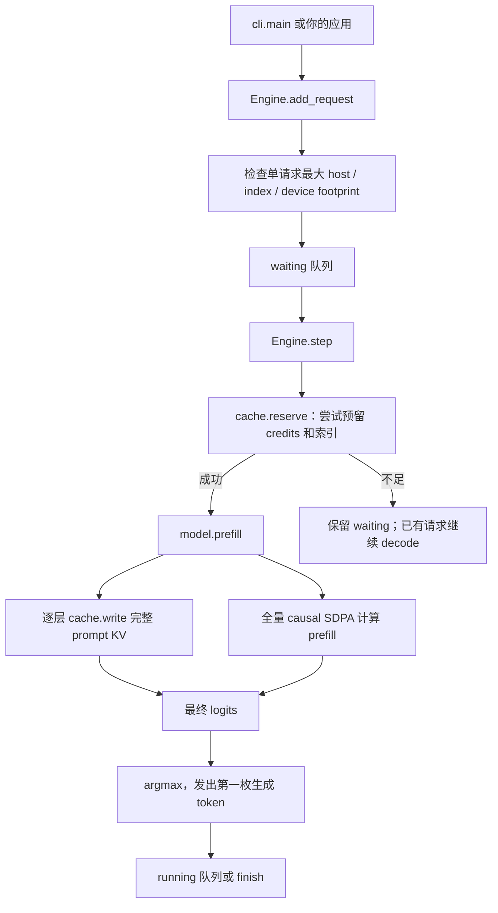
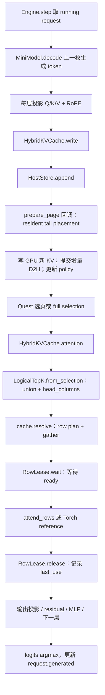
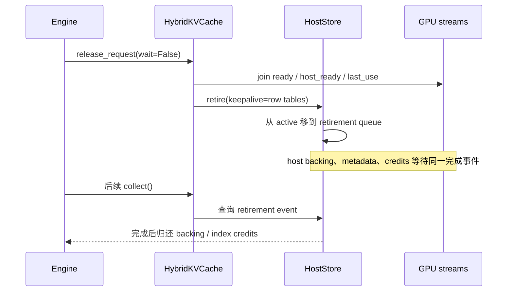

# 跟着代码走一轮 decode

[文档首页](README.md) · 前置：[图解设计](visual-guide.md) · 下一步：[运行例子](examples.md)

从默认 `hybrid` 路径读起。`reference/` 和 `experiments/` 是显式调用的对照工具，不在默认推理的依赖链上。

## 先找这六个入口

| 阅读顺序 | 文件 / 符号 | 看什么 |
|---:|---|---|
| 1 | [engine.py](../mini_hisparse/engine.py) · `Engine.step` | 准入一次 prefill，之后循环 decode；结束时释放 |
| 2 | [model.py](../mini_hisparse/model.py) · `prefill` / `decode` | Q/K/V 来源、先 append 后选 token、调用 cache attention |
| 3 | [hybrid.py](../mini_hisparse/hybrid.py) · `write` / `resolve` | resident/hot 协调和 RowLease |
| 4 | [row_index.py](../mini_hisparse/row_index.py) · `resolve_rows` | 从逻辑 token 到物理 row 的完整算法 |
| 5 | [row_kernels.py](../mini_hisparse/row_kernels.py) · `gather_rows` / `attend_rows` | 只搬 miss，等待后按 row 读 K/V |
| 6 | [storage.py](../mini_hisparse/storage.py) / [allocator.py](../mini_hisparse/allocator.py) | append、镜像版本、延迟回收与 block generation |

## 从用户请求到第一枚生成 token

`reserve()` 同时考虑 host backing、常驻索引和 hot/tail credit。它保证后续存储进展所需的资源，不是给完整请求分配 GPU KV。

Prefill 临时完整 K/V 和模型 activation 仍占 GPU 空间。因此 `--gpu-pages` 只限制**持久 KV pool**，不能据此承诺长 prompt 在任意小总显存下都能 prefill。

## 一步 decode 的调用链

Selection 的可见长度包含刚追加的新 KV。使用过期 length 的 selection 会被拒绝。`--top-k 4` 是 Quest 每 query head 的页预算；不同头可选不同页，所以 hot 配额必须覆盖 token **并集**，不能只按 `4 * page_size` 估计。

`model.decode()` 只调用 `cache.attention()`，不判断是 hybrid 还是 page reference。Hybrid 自己调用物理 row attention；只有显式选择 `--cache-layout pages` 才进入参考实现的分窗路径。

## Resolver 的八个步骤

按 [row_index.py](../mini_hisparse/row_index.py) 中 `resolve_rows()` 的顺序读：

| 步骤 | 中间变量 | 目的 |
|---|---|---|
| 归一化、排序、去重 | `normalized, logical, unique` | 无效或未来 token 屏蔽，同一 token 不重复计入 |
| 计算 source / resident 地址 | `page, offset, host, resident_hit` | resident 命中直接绕过 hot |
| 查 hot tags | `sorted_tags, existing_slots, hot_hit` | tags 存 host physical row |
| 保护本步全部 hits | `protected` | 后出现的 hit 不会被先出现的 miss 逐出 |
| 选 victims 和落点 | `victims, miss_rank, assigned` | 只从未保护 slots 按 LRU 分配 |
| 更新内容目录和顺序 | `tags, lru` | 替换 hot 内容，不改变 block 租约 |
| 构建固定形状 miss plan | `host_plan, device_plan` | 有效前缀 + -1 padding，无需读回 miss count |
| 恢复输入与逐头映射 | `first_input, head_columns` | 输出 attention 所需 physical rows |

算法使用多个 Torch device 运算，便于阅读和测试；它不是 vLLM 的 fused resolver。独立 resolver 的 CUDA Graph 测试不等于完整引擎支持 Graph。

可以先跑 [地址例子](../examples/inspect_indices.py)，再看 `tests/test_hybrid.py` 中 hot hit 保护、重复输入、分散 block 和 Graph 等测试；用 `rg '^def test_' tests/test_hybrid.py` 列出入口。

## 谁负责什么状态？

| 所有者 | 保存的状态 | 不负责的事情 |
|---|---|---|
| `HostStore` | 逻辑页、host credit、摘要、镜像版本、retirement | 不选择 hot 或页级 victim |
| `DeviceAllocator` | 唯一 GPU pool、owner、generation、free/reclaimable | 不决定模型选哪些 token |
| `HybridKVCache` | hot/tail admission、驻留策略、LayerTables、row lease | 不计算 learned top-k |
| `resolve_rows` | 本轮 tags/LRU 与 miss plan 更新 | 不申请 GPU blocks，不等待 CPU 逐个 miss |
| `Engine` | waiting/running 队列、输出 token、请求结束 | 不做生产级 continuous batching |

组合关系让默认实现可单独阅读；page reference 共享 HostStore/Allocator 的基础存储能力，但拥有独立的页替换和 attention 策略。[重构与 API 迁移](refactor.md)。

## Finish / cancel 不等于可以立即覆盖内存

GPU slot 的 owner/generation 与 fence 保护复用；request generation 防止 ID 重用后旧句柄误命中新请求。Row tables 通过 `keepalive` 与 host backing 一起存活到退休事件，避免“预算已归还，但 GPU 仍用着那份表”的问题。

Engine 的 round-robin 只是串行给每个 running request 一次 decode 机会；每轮最多新准入一个 prompt。首次准入当轮可能同时产生一次 prefill token 和一次 decode token。排查 admission 时应看 waiting/running 和请求计数，而不能把它解读成一个 GPU batch 的吞吐。
