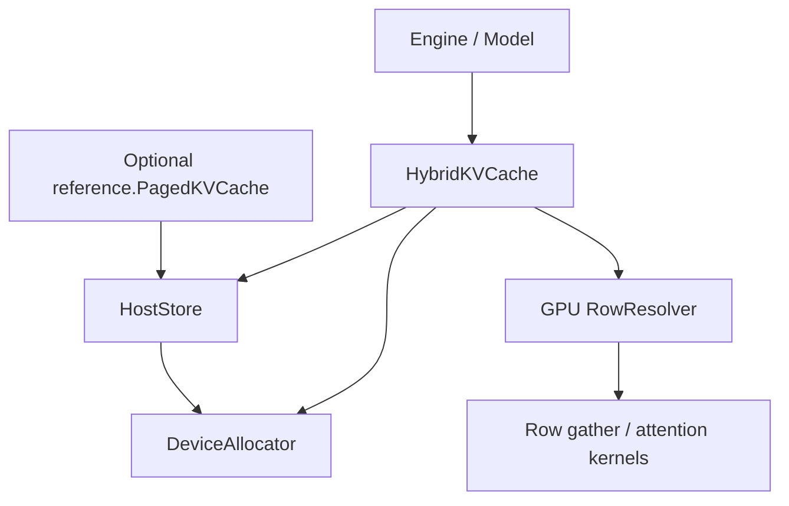
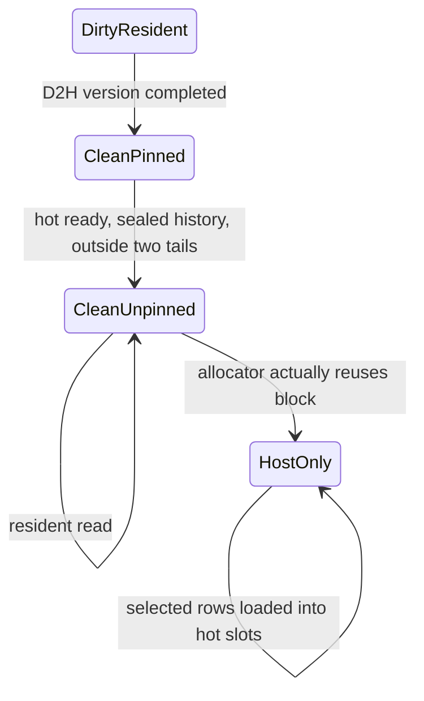

# Architecture

The default `hybrid` path separates **logical KV history**, **physical block ownership**, and **hot row contents**. The optional page-based reference has its own [design](page-cache.md).

For a worked address example, state diagrams and a stream sequence diagram, start with the [illustrated guide](visual-guide.md). The [code walkthrough](code-walkthrough.md) maps each operation to its implementation; [examples](examples.md) exercise those paths.

## Components and dependency direction



`HybridKVCache` is a standalone class, not a subclass of the reference cache.
`HostStore` owns logical pages, host credits, summaries, mirror versions and
retirement events. It receives `prepare_page` / `after_write` callbacks for an
append, but has no hot allocation, page victim selection or window policy.
`DeviceAllocator` owns the GPU slab and block generations. Hybrid decides when
to unpin/reuse history and how to lease hot blocks; the GPU resolver replaces
rows within those already-leased blocks.

`model.decode()` constructs a `Selection` and calls `cache.attention()`; it
never dispatches through page attention or checks a cache's concrete type.
The reference implements the same operation in its own package. The CLI
imports optional packages only when `--cache-layout pages` or `bench` is chosen.

Caller-owned metadata bytes are reserved with host/index credits. When a
request retires, `HostStore.retire(keepalive=...)` retains its row tables through
the same completion event as host backing, so their physical lifetime and
index-budget lifetime cannot diverge.

## Three granularities

| Unit | Identity | Responsibility |
|---|---|---|
| Logical page | `(request_id, layer_id, page_index)` | A stable interval of token positions with host backing |
| Physical block | A slot in the shared GPU tensor | Capacity leased to a resident page or a hot region |
| Token row | One token's K/V across all KV heads | The unit selected, cached in hot slots and loaded on a miss |

Both the GPU pool and the host pool use `[blocks, 2, page_size, kv_heads, head_dim]`. The GPU pool is a single allocation. A hot region is a list of leased blocks in that allocation, not a separate KV tensor. Its blocks need not be contiguous.

## Address translation

Each request/layer has a host source table, resident block table, hot block table, hot tags and row LRU state. For a selected logical token `t`:

```text
page, offset = divmod(t, page_size)
host_row = source[page] * page_size + offset

if resident[page] >= 0:
    physical_row = resident[page] * page_size + offset
else:
    hot_slot = lookup(host_row) or choose_an_unprotected_victim()
    physical_row = hot_blocks[hot_slot // page_size] * page_size + hot_slot % page_size
    on_miss: gather(host_row, physical_row)
```

The resolver protects all selected hits before assigning victims, deduplicates selected tokens, and masks invalid/future positions. Attention consumes physical row IDs after the gather completion event. Duplicate token IDs do not receive duplicate softmax mass.

`LogicalTopK` accepts a shared device tensor `[K]`. Per-head selections use a token union plus head-column mappings so each row is copied once while each query head keeps its own mask. The Quest adapter currently constructs this union on the CPU; native device input avoids that adapter.

## Page state and capacity



Unpinning makes capacity reclaimable without invalidating its bytes or resident mapping. `allocator.free` contains empty blocks; `allocator.reclaimable` contains readable blocks with reuse callbacks. Empty blocks are allocated first. A consumer lease temporarily removes a readable block from available capacity without discarding its mapping.

The last two logical pages of each layer stay resident. Every admitted request reserves capacity credits:

```text
layers × (ceil(hot_rows / page_size) + 2)
```

History may borrow unused credits until hot space is needed. Watermark or resident-window pressure sets a persistent hot demand; a complete hot region must be available before normal clean-history unpinning. The default 64-page resident window is a configurable teaching parameter, not a sliding attention window or an upstream constant. See [the exact transition rules and remaining scheduler differences](residency-alignment.md).

Host and index capacity have separate admission budgets. New requests may wait; an admitted request never has to restore its entire history or redo prefill. Admission does not bound model weights, activation memory or temporary prefill tensors.

## Stream order and lifetimes

```text
compute : append new KV -> resolver -> resolved event
transfer: wait append -> D2H new KV -> wait resolved / previous reader
          -> gather missing rows -> ready event
compute : wait ready -> physical-row attention -> last_use event
```

The same transfer stream orders host mirrors before host reads. Triton gathers missing rows through the CUDA device alias of pinned host memory; this uses SM loads, not a DMA copy engine.

`host_enqueued_version` records submitted mirrors; `host_committed_version` advances only after the corresponding event completes. Normal residency ticks query events without blocking. If the synchronous prefill runner runs out of allocatable blocks while useful mirrors are pending, it may wait for one relevant completion event.

Each request/layer permits one active row lease. It conservatively protects all of that layer's resident pages to avoid reading GPU-selected page IDs back to the CPU. After the host-side lease is released, events still protect pending GPU readers. Slot owner/generation pairs reject stale handles. Request retirement delays host-page and metadata reuse until in-flight operations finish.

## Implementation boundaries

The GPU resolver is a sequence of PyTorch operations, not an upstream fused CUDA kernel. Per-layer hot states do not share cross-layer miss plans. The Python scheduler has no HMA groups, chunked-prefill admission window, tensor-parallel completion aggregation, prefix sharing or concurrent batch execution.

These are deliberate limits of the current project. The [alignment notes](hybrid-alignment.md), [tests](../tests/) and [validation reports](validation.md) make the supported behavior and evidence inspectable.
