# 页级参考路径的部分驻留解码设计

本页描述 `reference/cache.py` 中独立保留的 `PagedKVCache` / `--cache-layout pages` 路径。默认 hybrid 路径已拆分 block 租约和 token-row 内容替换，使用 GPU 地址解析；其当前设计、容量公式与 vLLM 对照见 [hybrid-alignment.md](hybrid-alignment.md)。本页的单槽进展、软尾页保护和 CPU resolver 不适用于 hybrid。

## 1. 身份、存储、可读性是三件事

逻辑页键为 `(request_id, layer_id, page_index)`。一页覆盖同一层的连续 `P` 个 token，包含该层全部 KV heads 的 K/V。准入时只预留 host 容量 credit；首次写入该逻辑页时才建立 `Page` 对象并分配稳定的 `host_slot`。`gpu_slot` 可以缺失或变化，逻辑身份不变。未使用的输出长度不再创建成千上万个页对象。

GPU KV 唯一分配为 `[G, 2, P, Hkv, D]`，host pool 为同布局的 pinned CPU tensor。`DeviceAllocator` 负责物理槽、空闲集合、LRU、请求占用计数和 generation；`HostStore` 负责逻辑页、host 内容与搬运事件，`reference.PagedKVCache` 只负责页级获取、逐出和窗口规划。allocator 的 slot owner 是反向页表，`Page.slot` 是正向映射。resident 和 hot 指向同一底层 tensor，区别仅是内容来源及策略，不是两份内存。

一个枚举不足以表达异步状态，因此拆成以下正交字段：

| 信息 | 字段 | 含义 |
|---|---|---|
| 逻辑身份 | `key`, `host_slot` | 请求存活期间稳定 |
| 放置策略 | `location = HOST / RESIDENT / HOT` | 无 GPU 副本 / 持久保留 / 缺页加载的可复用副本 |
| 有效范围 | `valid_tokens` | 尾页只读已写入的 token，屏蔽未初始化区域 |
| CPU 生命周期 | `pins` | 未提交完消费者的租约数；大于零禁止逐出 |
| GPU 可读时间 | `ready` | H2D 或 KV 写入完成事件；未完成即处于 loading/writing |
| GPU 可复用时间 | `last_use` | 最近一次 attention 消费者完成事件 |
| host 可读时间 | `host_ready` | 增量 D2H 镜像完成事件；未完成即处于 writeback |
| 防止 ABA | request / slot `generation` | ID 或槽号复用后，旧 lease 不能误指向新内容 |
| 内容版本 | `content_version / host_enqueued_version / host_committed_version` | 严格区分最新内容、已排队镜像和已完成镜像 |
| 页封口 | `sealed` | 有效 token 达到页大小，之后只读；新 token 写下一页 |

`HOST` 不等于“CPU 此刻已可读”：必须等待 `host_ready`。`HOT` 不等于“GPU 此刻已可读”：必须等待 `ready`。CPU 诊断读取会同步；decode 在 stream 上建立依赖，不在每次缺页时调用全局同步。

## 2. 状态转换

```mermaid
stateDiagram-v2
    [*] --> HostReserved: 准入，保留 host backing
    HostReserved --> Resident: 写入 prefill / 新 KV
    Resident --> HostOnly: 压力逐出，槽位附带 reuse fence
    HostOnly --> HotLoading: 只加载本轮窗口需要的页
    HotLoading --> Hot: ready event 完成
    Hot --> Hot: 命中并续租
    Hot --> HostOnly: 可复用且被选为 victim
    Hot --> Resident: 追加到已重载的尾页
    Resident --> Freed: 请求结束，排空在途操作
    HostOnly --> Freed: 请求结束
    Hot --> Freed: 请求结束
```



流程中的 loading/writeback 是事件表达的瞬态，不要求 CPU 轮询后才能发下一条 GPU 命令。

写穿流程：compute 写新 K/V → 记录 `ready` → transfer 等待它 → D2H **仅新增的行** → 记录 `host_ready`。这让已镜像历史页的逐出不再需要临时申请 CPU 空间，也不必在缺页关键路径上先做整页备份。代价是即使不发生压力也会消耗 D2H 带宽和 host 内存。

逐出流程：确认 `pins == 0` → transfer 等待 `ready / last_use / host_ready` → 记录该物理槽的 fence → 清除旧页映射。新租约可立即得到槽号，但新写入/H2D 必须排在 fence 之后。“逻辑空闲”和“物理字节可覆盖”严格分离。

本实现只有一个控制线程和一个 compute stream；所有读者先后提交到同一 stream，最新 `last_use` 覆盖更早读者的依赖。lease 同时保存 slot、generation 与 owner，验证后才能读或释放。多个 compute stream 或跨进程仍需要聚合所有消费者事件；generation 本身不能替代该同步。

完成或取消使用 `release_request(wait=False)`：解绑 GPU 槽但保留复用 fence，把 host 页和索引所有权放进 retirement queue。只有完成事件可见后 `collect()` 才归还 host 页；调度器正常轮询不阻塞 CPU。空闲时的 admission 回压与最终 drain 可以等待 retirement event。旧请求和新请求即使 ID 相同，也有不同 generation，退休对象不会误删新页。

## 3. 共享池中的容量分配

设实际 GPU KV 槽数为 `G`，配置窗口上限为 `Cmax`：

- 串行模式：`C = min(Cmax, G)`。
- 重叠模式且 `G >= 2`：`C = min(Cmax, floor(G / 2))`。
- `G == 1` 自动退化为逐页串行处理。

保证每次只持有当前与下一窗口，最多 `2C` 个槽。新 token 在 attention 前写入，尾页也可以被安全逐出，所以不用永久给每个请求固定保留一个尾页槽。**尾页位置可以变化，但其新增数据不能丢失。**

`WindowPlan` 按本轮所有 head 的真实页面并集计算，先扣除其他消费者持有的 lease，再决定一个或两个窗口。**每头 top-k=4 并不代表只需要 4 个物理页**。当前实测每头 4 页的 Quest 选择，页面并集平均约 10.1 页。

这是可回收的容量保证，不是一块永远闲置的 hot 分区。resident 可以占满空闲槽，缺页时才回收未被租用的页。默认 `fair_lru` 依次考虑：

1. 未封口尾页，以及过去两轮层级 attention 中确实访问过的 sink 页，获得软保护。
2. 尽量不逐出本轮尚未消费的 selection 命中页（lookahead）。
3. 优先从占用超过 `max(1, G / active_requests)` 软目标的请求回收。
4. 其余按访问时间 LRU，hot 不再天然比冷 resident 更容易被逐出。

所有保护和配额都可被压力打破，只有 in-flight lease 是硬约束。sink 保护会过期；一个请求可借用整个空闲池。`legacy` 保留原来的 hot-first 规则，`lru` 提供无软配额/anchor 的对照。不同策略有不同工作负载取舍；见第二轮消融实验。

`acquire()` 先检查“现有 pinned 页 ∪ 本轮页”的大小，再锁定本轮所有 hit，最后解决 miss。否则先处理一个 miss 时，可能把本轮尚未处理的 hit 逐出。无法满足的租约在改变状态前抛出容量错误；正常 attention 通过窗口拆分避免该错误。

准入检查 host credit：`layers × ceil((prompt + max_new_tokens) / P)`，以及 GPU 索引字节预算。已经退休但事件尚未完成的 host 页和索引仍然占容量。host/index 不够时只让新请求等待；已有请求的容量已经预留，仍轮转 decode。每轮最多准入一个 prompt，并让运行请求前进一步；取消会回收该请求。没有批处理或 prefill 时间切片，长 prefill 仍可能增加 decode 延迟。

## 4. 比 GPU 池更大的 selection

不能把分块 softmax 的输出直接平均。对窗口 `i` 保存：

```text
m_i = max(scores_i)
l_i = sum(exp(scores_i - m_i))
a_i = sum(exp(scores_i - m_i) * V_i)

m = max(m_1, m_2)
l = exp(m_1 - m) * l_1 + exp(m_2 - m) * l_2
a = exp(m_1 - m) * a_1 + exp(m_2 - m) * a_2
output = a / l
```

按窗口归约与对同一 token 集合一次性 attention 数学等价，只有浮点归约顺序不同。`Selection` 保存每个 query head 的精确 token 集合，重复 ID 去重，允许 `-1` padding，拒绝未来位置。窗口只加载各 head 所需页的并集，mask 仍精确到 token。一个 head 在当前窗口可能没有任何 token，此时其 `(m,l,a)=(-inf,0,0)`，合并不能产生 NaN。

Triton 每个 program 负责一个 query head，按 slot 索引直接读取池中的 K/V，计算一个窗口的 `(m,l,a)`。GQA 用 `query_head // groups` 映射 KV head。Python/PyTorch 合并窗口状态；不会先拼接完整 selection 的 K/V。CPU reference 为清晰起见逐页计算并可复制 GQA heads，临时空间仍以单页为界。

## 5. 搬运与计算流水

```text
transfer: H2D(window 0) ── H2D(window 1) ── wait(last_use 0) ── H2D(window 2)
compute : wait(ready 0) ── attention 0 ── wait(ready 1) ── attention 1 ── ...
                           record(last_use 0)
```

先提交下一窗口的搬运，再提交当前窗口的 attention。窗口内所有页已获租约，不会互相逐出；当前窗口最后一个 kernel 入队后才解除 CPU pins，事件继续保护 GPU 字节。D2H 与 H2D 共用 transfer stream，简化读写依赖，也限制了双向搬运并行能力。

这里实现的是**确定性窗口预取**：下一窗口来自本轮已经确定的 selection。没有预测未来 token 的 top-k，也没有假设不同层选中相同页。上游共享 indexer 的跨层预取可以作为扩展，前提是模型确实共享选择结果。

允许 overlap 不等于证明更快。小页 DMA、Python 发射、页表遍历、metadata 上传和 top-k `.tolist()` 都可能占主导，必须结合 trace 与端到端时间判断收益。

## 6. 内存账本与边界

```text
单层一页字节 = 2 × P × Hkv × D × sizeof(dtype)
GPU KV 主池  = G × 单页字节
host pool   = H × 单页字节（pinned）
页摘要索引  = 预留层页数 × Hkv × D × (4 + 2 × sizeof(KV dtype))
```

索引包含 FP32 mean 与 KV 原 dtype 的 min/max（极值是实际 K 值，可以精确表示），它有独立的 `index_budget_bytes` 准入限制。BF16 比三个 FP32 摘要少用三分之一索引空间。摘要、模型权重、hidden state、Q、输出归约、临时 metadata 和 prefill workspace 不包含在 `gpu_pages` 中。小 KV 池下索引可能比 KV 主池更大，因此只报告 KV 主池缩小倍数会误导。

随机微基准的 oracle 历史在 CPU；真实轨迹分析/prepare 可以把离线历史放在 GPU，且明确在计时外。这是实验辅助内存，不属于 runtime cache 的容量承诺。回放保留少量 query/new-KV/expected 输出，也独立计于缓存之外。

最小进展条件是：模型和必要 workspace 能运行、至少一个 KV 槽位、host 足以保留已准入请求。此方案不会在显存为零或 host 无限增长时作出虚假的进展承诺。

## 7. 哪些测试能证伪实现

- 同一 logical selection 在大池与小池之间输出不同：映射、复制、屏蔽或归约出错。
- 延迟 compute 后立刻重用单槽，读到下一页：缺少 `last_use` fence。
- 追加尾页后逐出、重载发现旧值：写穿与 `host_ready` 出错。
- 本轮 miss 逐出了本轮 hit：没有先保护全体 hit。
- 请求结束后 host 槽不恢复或新请求读到旧值：回收生命周期错误。
- 连续 decode 后 `prefill_count > 1`：退化成了请求级重算。
- top-k 大于 GPU 容量时等待整批槽：没有真正实现窗口化进展。

对应测试位于 `tests/test_cache.py` 与 `tests/test_engine.py`，同时覆盖 CPU 和真实 CUDA，不以模拟 event 代替并发依赖验证。
