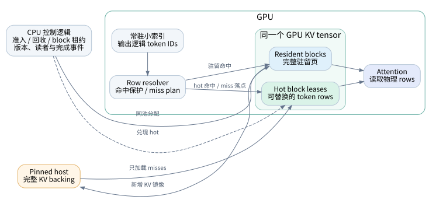
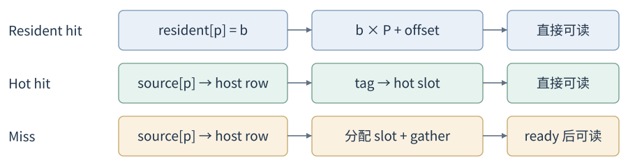
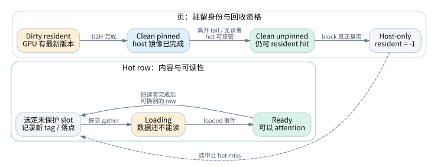
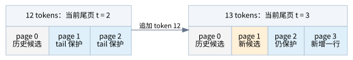
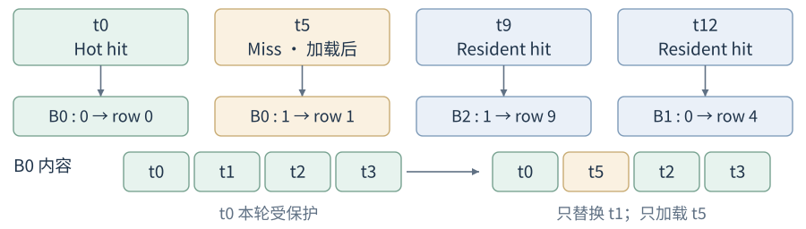
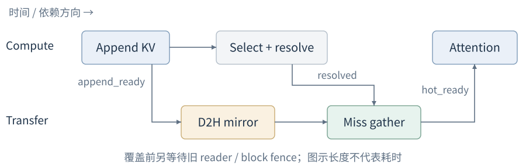
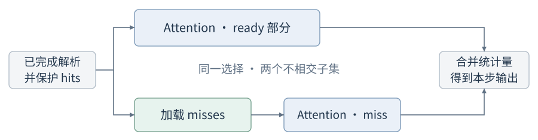

# 显存受限下的持续解码

**一种基于共享显存池与有界工作集的部分驻留 KV Cache 设计**<br>
系统设计答卷 · 2026 年 11 月 · 基于 mini-hisparse 的实现约束

**摘要**　长上下文请求的 KV 历史可能超过其可获得的显存，但一次稀疏 attention 只读取其中的一部分。本文据此将“保存完整历史”和“执行当前一步”分开：以 host backing 保存历史，以同一个 GPU tensor 承载驻留页和可复用的 hot buffer，并在 decode 时把逻辑选择翻译为可读的物理行。方案的关键是为每个已准入请求预留足够的单步工作集，再以版本和完成事件约束页面回收。由此，请求即使只保留少量驻留页，也能在按需加载后继续生成，无需恢复全部历史或重新 prefill。下文依次建立地址模型、推导容量条件、给出执行协议，并讨论等待隐藏与验证方法。

## 1. 问题与设计思路

Prefill 产生初始 KV；decode 每步追加新 KV，并读取历史以生成下一个 token。显存充足时，KV 优先保留在 GPU。压力出现后，系统逐页释放驻留空间；被卸载的历史仍可被后续 attention 选中。题目的难点在于：**hot buffer 与驻留页争用同一个显存池，回收之后必须仍有空间承接下一步的缺失数据。**

本文采用单 GPU、单控制器管理多请求的模型。每层的选择器输出本步各 query head 的逻辑 token 集合；索引状态常驻 GPU，历史 KV 写入后不再改变，当前尾页只追加。我们保证的是：对已声明的选择集合，缓存布局变化不改变 attention 的输入；在预算与异步操作完成的前提下，已准入请求持续前进。稀疏选择本身与 dense attention 的质量差异不属于缓存正确性。



*图1　计算路径始终处理同一份逻辑选择。Resident 提供直接读取，hot 提供缺失行的落点；两者是同一 GPU 池的不同用途。Host 另占受预算约束的 pinned memory。*

设计由一个容量关系贯穿：**显存必须覆盖本步工作集，而不必覆盖完整历史。** 第 2 节先说明历史如何在回收后仍可寻址；第 3 节证明工作集一定有落点；第 4 节把这两点组合成可执行的 decode；第 5、6 节再讨论性能、正确性与边界。

<!-- pagebreak -->

## 2. 稳定逻辑地址与可变化的驻留状态

### 2.1 以页分配空间，以行表达选择

逻辑页表示某请求、某层的一段连续历史；物理块是 GPU 池中可以重新分配的空间。两者生命周期不同，因此不能用 GPU block ID 作为历史身份。一个逻辑页的完整身份为 `(request_id, request_generation, layer, page_index)`；请求代次用于区分取消后重复使用的 ID。

设每页容纳 P 个 tokens。一个 **KV row** 是一个 token 在该层的 K/V，包含全部 KV heads。分配和卸载以页为单位，稀疏读取与加载以 row 为单位。这样，选中同页中的一个 token 时，只需搬运这一行。

```text
GPU / host 布局 = [blocks, 2, P, kv_heads, head_dim]
page, offset = divmod(token_id, P)
physical_row = block_id * P + offset
```

`physical_row` 是地址编码，attention 据此定位 K/V 两个平面。多个请求和层共用 GPU tensor；每个物理块同时只属于一个 resident 页或一个 hot 区域。Hot blocks 可以不连续，不能通过假定连续切片来寻址。

### 2.2 三张映射表组成一条读取路径

| 元数据 | 表达的事实 | 何时改变 |
|---|---|---|
| `source[page]` | 该页稳定的 host block | 页创建时绑定；请求退休后回收 |
| `resident[page]` | 该页当前 GPU block，或 −1 | 驻留时建立；实际复用时撤销 |
| `hot_blocks` 与 `tags` | hot slot 的物理落点及缓存的 host row | blocks 整组分配；tags 按步替换 |
| 页记录 | 有效行数、写入/镜像版本、是否封页、读者数 | 追加、镜像完成、租约变化 |
| 块记录 | owner、generation、旧访问的完成事件 | 物理块交接 |

读取先查 resident；未驻留才把逻辑地址换成 host row，查找 hot tag；仍未命中才产生加载计划。**Hot 中的一行是 host 历史的副本，不能反过来成为唯一历史来源。** 对同一 row 的跨头选择只搬运一次，同时保留逐头选择映射，避免把并集错误地当作每个 head 的输入。



*图2　同一个逻辑 token 最终只得到一个 GPU 物理地址。Miss 分支先确定落点，数据完成加载后该地址才可被 attention 使用。*

至此，卸载只会改变读取路径，不会抹去历史身份。接下来需要规定，何时可以安全地改变这条路径。

<!-- pagebreak -->

### 2.3 页面回收是一种受完成条件约束的状态转换

新 KV 先写入 resident 尾页，再异步镜像新增 rows 到 host。Host 的“完整历史”是持续维护的存储承诺：镜像尚未完成的最新数据仍由 GPU 原件保护，不能提前回收。Prefill KV 也遵循同一规则；若来自独立 prefill 实例，必须在导入数据和地址映射就绪后开放 decode。



*图3　上行是逻辑页生命周期；下行是临时副本生命周期。Host-only 页的若干 rows 可以同时存在于 hot，但它并未因此恢复为 resident 页。*

**从 dirty 到 clean。** 每次追加递增内容版本 `v`；提交 D2H 时记录 `v_enqueued` 和完成事件；只有事件完成后，才把该版本发布为 `v_committed`。回收要求 `v_committed = v`。页已写满或 copy API 已返回，都不能替代这个条件。

**从 clean 到 reclaimable。** 一个页还需满足：已经封页，位于受保护尾页之外，没有活跃消费者，并且所属请求/层已有 hot 落点，或正在完成一次完整的 hot 分配事务。Reclaimable 只表示可被借走；原数据和 resident 映射仍有效，再次选中时仍直接命中。

**从 reclaimable 到 host-only。** 只有 allocator 真正复用物理块时，才撤销旧 resident entry、交接 owner 并递增 block generation。新写者必须等待旧写入、镜像和读取汇合后的 fence。这样既保留了最后一次驻留命中的机会，也避免旧映射指向新 owner 的字节。

### 2.4 租约保护映射，事件保护字节

消费者持有租约期间，控制器不能撤销其映射。CPU 释放租约时，GPU 上的 attention 可能仍在运行，因此释放动作还必须记录 `last_read` 事件；下一次覆盖要等待该事件。引用计数归零与数据可覆盖，是两个不同的判断。

Hot 的 tags 同样可能早于数据更新：resolver 写入新 tag 只表示“已分配落点”，`hot_ready` 才表示 gather 完成。请求结束或取消时，host backing、miss plan 和映射表也要保留到在途操作结束；重复 request ID 使用新代次，旧块句柄通过 generation 校验失效。于是，页回收、slot 替换和请求退出都遵循同一原则：**先结束旧访问，再复用其地址。**

<!-- pagebreak -->

## 3. 用单步工作集约束共享池分配

### 3.1 在准入时承诺最小容量

设 U 为一个请求/层每步所选 token 的**跨头并集上界**，H 为该层 hot 可用 rows，L 为层数，G 为 GPU KV 池总 blocks。当前追加页及其前一页组成两页保护区。本文使用保守而易验证的准入条件：

```text
H ≥ U
C_request = L × (ceil(H / P) + 2)
Σ C_request ≤ G
```

C 是容量承诺（credit），不是立即占用的物理块。Hot 尚未启用时，resident history 可以借用这些空间；发生压力时，系统按后文的事务把承诺兑现为固定 hot blocks。Hot 一旦建立，在该请求存活期间保持 block 租约，内部 rows 则反复替换。

同时按最大请求长度预留 host 页额度，并为常驻索引、映射表预留 GPU 字节。KV 池 G 必须从模型权重、激活和 workspace 之外的可用显存中划出。任何一项预算不足，新请求等待准入；已准入请求的最低配额不能再被超订。

### 3.2 单步容量的充分性与尾页轮转

将本步去重后的选择分成 r 个 resident hits、h 个 hot hits 和 m 个 misses。保护全部 hot hits 后，有：

```text
r + h + m ≤ U
可替换 hot slots = H − h ≥ U − h ≥ m
```

因此，即使选中的历史全部不驻留，misses 仍有落点。Hot 旧内容可直接替换，因为 host 已有其有效副本。H=U 已足以承接当前选择；H>U 可保留更多跨步内容，但会占用本可用于 resident 的空间，命中率不一定单调改善。实现默认 H=2U，是策略取舍。

两页 tail 则给追加路径提供稳定落点。跨页时，先用**即将追加的页号**移动保护区，再申请新 block；旧尾页只有通过第 2 节的安全条件后才能让位。



*图4　贯穿示例：P=4，U=H=4，单层、G=3。追加 t12 时，p1 离开尾页保护区；其镜像和旧读者完成后，B1 可从 p1 改为 p3。历史 p0、p1 留在 host，hot B0 始终存在。*

这三个 blocks 足以维持缓存层的增量解码，尽管历史会不断增长。新增的存储需求落在已预留的 host 与索引预算中。

<!-- pagebreak -->

### 3.3 从全驻留转入部分驻留

容量承诺还需要一个可执行的兑现过程。控制器在空闲/可回收 blocks 低于水位时设置持久 `hot_required`，在申请新 tail block 前也要预判消耗后的容量。实现还允许驻留窗口阈值提前触发转换；阈值只控制何时释放空间，不截断可被选择的历史。

第一次申请 hot 必须是整组事务。先收集空块和安全候选，确认能得到 `ceil(H/P)` 个 blocks，才撤销任何旧映射。尚无 hot 的请求可以贡献自己的安全历史页，但贡献动作必须与建立完整 hot 区域一起提交。否则，卸载了一部分页却没有足够 hot 落点，会破坏准入承诺。

```python
# 单控制器串行修改元数据；安全候选已通过镜像、tail、读者检查。
def ensure_hot(group):
    if group.hot_exists: return READY
    group.hot_required = True
    if group.has_consumer: return WAIT_READER
    need = ceil(H / P)
    candidates = unique(empty + reclaimable + safe_own_history(group))
    if len(candidates) < need: return WAIT_RESOURCE

    chosen = candidates[:need]             # 完整预检后才提交
    for block in chosen:
        revoke_old_mapping_if_owned(block)
        transfer.wait(old_access_fence(block))
        bind_hot(block, group, next_generation=True)
    publish_hot_blocks(group, chosen, transfer.record_event())
    mark_safe_history_reclaimable(group)
    return READY
```

候选短缺时，申请和所有旧映射都保留。调度器随后根据未完成镜像或消费者事件重试；如果尚未转换的某个组占有超出自己承诺的历史空间，则先为该组兑现 hot，再取回多余 blocks。准入保证总容量，事务保证兑现期间不破坏请求的可执行状态。

### 3.4 将驱逐策略分成块回收与行替换

块层面先用空块，再用已可回收的 clean 历史块，最后尝试上述转换事务。尾页、dirty 页和活跃消费者保护的页不进入候选。最小实现把同组合格历史页按页号从大到小放入回收队列，再按队列复用；这是一种可解释的启发式，不是全局访问 LRU。改变候选优先级只影响命中机会，不应改变安全门槛。

行层面只在已经拥有的 hot blocks 内工作：先找齐本轮所有 hot hits 并保护，再给 misses 选择未保护的 LRU slots。必须对整个选择集合完成命中判定后再替换，否则前面遇到的 miss 可能覆盖后面才遇到的 hit。行替换不向全局 allocator 再申请空间。

若当前唯一障碍是镜像或旧 reader 尚未完成，等待的是该事件，而非整个请求的显存恢复。生产调度器可在等待期间执行其他请求；当前教学实现必要时等待一个有用的镜像事件。两者都不能通过覆盖受保护数据来换取前进。

<!-- pagebreak -->

## 4. 一次部分驻留 decode 的完整执行

### 4.1 以三个物理块完成四个 token 的选择

沿用图 4 的状态：p0、p1 已在 host；B2 保留 p2，B1 保留刚追加 t12 的 p3。假设 B0 的 hot 内容为 `[t0, t1, t2, t3]`，本步选择并集为 `{t0, t5, t9, t12}`，其大小恰为 U。



*图5　保护 t0 后，为 t5 选择未保护 slot 1，替换 t1。只搬运 t5 一行；p1 不恢复驻留。图中物理行号按 `block×4+offset` 编码，attention 仍保留原逐头选择。*

本步有 r=2、h=1、m=1。t9、t12 直接读取 resident；t0 直接读取 hot；t5 等 gather 后读取 hot。最终物理行依次为 `[0, 1, 9, 4]`。四个逻辑 token 横跨四个逻辑页，但它们的本步计算只依赖已有的三个物理块。

### 4.2 解码协议

对每个请求/层，基础方案最多允许一个活跃消费者。进入以下流程前，控制器已满足追加所需的 block 分配，并完成必要的 hot 转换。`acquire` 保守保护该层所有 resident 页，避免将 GPU top-k 读回 CPU 后再逐页加锁。

```python
def decode_layer(query, new_kv, group):
    append_tail(new_kv)                     # compute：等待旧访问后追加
    mirror_new_rows_to_host()               # transfer：等待 append_ready
    selected, head_map = select_and_deduplicate(query)
    check_declared_bound(selected, U)
    lease = acquire(group)                 # 保护 resident 与 hot
    compute.wait(group.hot_ready)           # 上轮内容已完成
    plan = resolve(selected)               # 全体 hits → 保护 → miss 落点
    transfer.wait(compute.record_event())
    transfer.wait(group.last_read)
    gather(plan.misses)                     # 同流排在 host mirrors 之后
    group.hot_ready = transfer.record_event()
    compute.wait(group.hot_ready)
    out = attention(query, plan.physical_rows, head_map)
    lease.release_after(compute.record_event())
    return out
```

<!-- pagebreak -->

### 4.3 将“已提交”与“可以读取”分开

Resolver 在 GPU 上生成固定形状的 source/destination 计划，有效 misses 放在前缀，其余填 −1；gather 直接消费该计划。实现不需要把 miss 数量同步回 CPU，也不逐行发出主机端拷贝指令。这里的伪代码表达依赖协议，选择器与逐头映射的具体算法可独立替换。

基础方案使用一条 compute stream 和一条 transfer stream。它们的作用是表达依赖：同流保持顺序，跨流以完成事件连接；仅有两条 stream 并不保证硬件实际重叠。CUDA 的 stream/event 语义提供这一执行基础。[CUDA 异步执行文档](https://docs.nvidia.com/cuda/cuda-programming-guide/02-basics/asynchronous-execution.html)



*图6　横向表示先后关系，长度不表示实测耗时。Append 完成后，镜像与选择/解析可以并行；同层 attention 必须等待 miss gather。旧读者的完成事件还约束 hot 再次覆盖。*

这条事件链同时保证两件事。首先，transfer 上的新增镜像排在后续 gather 之前，gather 不会从尚未写好的 host backing 读取。其次，compute 在 gather 后等待 `hot_ready`，不会因 tag 已经更新就读取旧 slot 内容。对新追加 token，resident 路径直接读取 GPU 原件；后台镜像只是建立后续回收所需的副本。

| 将要执行的动作 | 必须先满足的依赖 |
|---|---|
| 覆盖 resident 物理块 | 旧写入、D2H 与 attention 读取均已结束 |
| 覆盖 hot slot | 该 slot 不属于本轮 hits；上轮 reader 已结束 |
| Attention 读取 miss 落点 | 对应 gather 完成，物理映射仍被租约保护 |
| 归还 host backing / 临时计划 | 所有在途拷贝及 kernel 已结束 |

这里使用“等待事件”表示流上的依赖，不等于让 CPU 阻塞。日常 decode 不调用 device-wide synchronize；CPU 仅在资源确实暂不可用时等具体事件。Miss plan 在 compute 产生、transfer 消费，因此还须显式延长 tensor 生命周期，防止异步内存分配器提前复用其存储。

单 transfer stream 使 host 写入与读取的顺序易于审查，代价是独立搬运可能排队。将来若拆为多条搬运流，就必须为每个 source 页补齐 ready 依赖；不能保留单流版本的隐含假设。请求结束时也沿这些依赖退休，而不因 CPU 已移除请求就立即释放其内存。

由此，第 2 节的状态、第 3 节的容量和本节的事件成为同一条执行链：逻辑历史可找到，本步空间可获得，正确版本在读取前可见。

<!-- pagebreak -->

## 5. 在正确依赖上减少与隐藏搬运等待

基础方案首先减少传输量。若一个 KV row 占 `b=2×kv_heads×head_dim×dtype_bytes` 字节，本步 H2D payload 为 `m×b`：resident/hot hits 不搬，未选中的历史不搬，跨头重复行只搬一次。D2H 也只镜像新增 rows，使日后回收尽量不临时等待整页写回。

这种粒度并不自动带来更低延迟。固定形状设备计划减少 CPU 往返；进一步融合 resolver 可减少 kernel launch。当前实现的 Triton gather 由 SM 读取映射的 pinned host 内存，不是 copy-engine DMA，它仍会与 attention 竞争 SM 和带宽。页内选择密集时，整页传输也可能更合适，应按相同选择与容量实测比较。

### 5.1 可选扩展：已就绪部分先计算

基础链条是 `resolve → gather → attention`。若缺失加载占据显著时间，可以把每个 head 的选择分为 ready 与 miss 两个不相交部分。Resolver 保护全部 hits 后，ready 部分可开始 attention，同时 gather 只写未保护的 miss 落点。



*图7　这是扩展设计，当前最小实现尚未启用。两个分支共享一份持续到合并结束的租约；不能在 ready 分支完成时提前释放。*

每个分区返回 FP32 统计量：最大 score m、归一化和 l、未除以 l 的加权向量 o。对分区 a、b，稳定合并为：

```text
m = max(m_a, m_b)
α = exp(m_a − m),  β = exp(m_b − m)
l = α·l_a + β·l_b
o = α·o_a + β·o_b
output = o / l
```

不能直接平均两份 attention 输出。空分区跳过；全空选择按接口约定返回零。这个合并保持同一选择下的数学结果，仅浮点归约顺序可能改变。忽略公共 resolver 成本，理想关键路径从 `T_gather+T_attn(all)` 变为 `max(T_gather,T_ready)+T_miss+T_merge`；是否获益取决于 kernel 开销与资源竞争。

### 5.2 预取必须有确定的选择来源

跨层预取只在后续层共享已知选择、source 已就绪且 hot 租约有效时成立；各层独立选择时，不能假定下一层 top-k 已知。下一 token 的 query 尚未产生，更不能把猜测性预取作为进展保证。生产系统还可用其他请求的计算覆盖等待，但本文的基础容量证明不依赖这些优化。

<!-- pagebreak -->

## 6. 正确性、验证与适用边界

### 6.1 将局部机制连成完整保证

**历史不会丢失。** 尚未完成 host 镜像的 KV 保留受保护的 resident 原件；允许回收的历史已有最新 host 副本。Hot 只缓存副本，任何 hot 替换都不删除唯一版本。因此，只要不超过已预留的最大长度，每个有效逻辑 token 始终可恢复。

**Attention 不会读错版本。** 解析期间的租约固定 resident/hot 映射；全体 hit 保护阻止本轮互相逐出；gather 与 reader 通过事件排序；generation 防止旧句柄在物理块复用后重新变得“有效”。所以每个选中 token 都对应其本层正确 KV，逐头 mask 保持不变。

**已准入请求可以继续前进。** 假设选择并集不超过 U、旧消费者最终释放、GPU 操作最终完成且调度公平。尾页之外的借用空间在镜像完成后可回收，完整事务兑现 hot；跨页追加可以沿图 4 移动尾页保护区。随后由 `H−h≥m` 知全部 misses 有落点，gather 最终完成，attention 生成下一步输出。等待只依赖有限的旧访问与搬运，不依赖完整历史重新驻留。该保证不等同于零等待或延迟上界。

### 6.2 通过相同选择检验存储语义

缓存层验证应固定 query、K/V 和逐头选择，再与完整 KV 上的同集合 attention 对照。若改用 dense 全集合，误差中会混入选择算法的影响；若漏掉 misses，则会把错误结果误当成加速。

| 要验证的性质 | 必须覆盖的情形 | 判据 |
|---|---|---|
| 地址与数值正确 | resident/hot/miss 混合，重复 token，padding，碎片化 hot blocks | 同选择输出在约定数值容差内一致 |
| 最小容量可前进 | H=U，每步全 miss，连续跨页追加 | 不增加 GPU blocks，不重新 prefill |
| 状态交接安全 | 延迟 D2H、旧 reader，取消并复用 request ID | 完成前不破坏旧数据；旧句柄失效 |
| 准入承诺有效 | GPU、host、index 任一预算不足 | 推迟准入，失败事务保留旧映射 |
| 优化有实际收益 | 同 trace、选择、KV 容量与 dtype | 同时报传输量、端到端耗时与时间线 |

本次对现有实现运行 `test_residency.py`、`test_hybrid.py`、`test_resources.py`，共 **53 项测试通过**，覆盖 CPU/CUDA 路径（其中 resources 含页级参考实现）。与本文最小容量推导直接对应的测试使用 P=4、U=H=4、G=3：32-token 初始历史之后连续追加 16 次，每步选择 4 个缺失 rows，合计 64 次 misses；每步结果与同选择基准一致，GPU 峰值不超过 3 blocks。Engine 测试还检查部分驻留期间不重做 prefill。

这些结果支持基础机制的实现正确性，不代表已经验证第 5 节的分区重叠收益。性能评估应分别记录 resolver、gather、attention、镜像等待和请求级 token 延迟；仅报告 hit rate 或减少的 H2D 字节不足以说明系统变快。

<!-- pagebreak -->

### 6.3 实现取舍与方案边界

本文以可核对的最小机制为目标。参考 vLLM HiSparse 的逻辑 source 与 GPU 租约分离方式，保留共享池、resident 优先解析和 host/hot 回退路径；其生产运行时的分布式协调、HMA 布局与多种 attention 后端不在本方案中复刻。[vLLM HiSparse 架构，固定源码版本](https://github.com/vllm-project/vllm/blob/abf98672ce7e822701f7a062bf240efb2c9900d1/docs/design/hisparse.md)

| 已有最小实现 | 本文讨论但未实现的扩展 |
|---|---|
| 单 GPU、同构 block pool；host/index/GPU 准入 | 分布式 P/D 传输、多卡协调、生产级异步调度 |
| 增量镜像、clean 回收、两页 tail、固定 hot 配额 | 动态 hot 配额与更精细的全局收益驱逐 |
| GPU 多算子 resolver、SM row gather、row attention | Fused resolver、ready/miss 分区重叠 |
| 每层独立选择与事件依赖 | 共享选择的跨层预取 |

固定 H 的优点是容易证明可前进，代价是按每层最坏并集预留空间。若大量 heads 的选择不同，U 可能远大于单头 top-k；容量计算必须使用并集上界。若选择集合没有固定上界，本方案不能保证一次装下，需另设分窗加载与在线 softmax 归约，不能静默截断选择。

主存和索引仍随历史长度增长。超过最大长度、host/index 预算或最低 GPU 配额时，应拒绝扩展或推迟准入。本文只保证 KV 路径的可执行性；prefill 的激活与临时工作区需独立预算，GPU 故障恢复也需要额外协议。

两页 tail 是本设计采用的保守保护策略，并非所有推理架构的理论最小值。更细的写入/读取范围追踪可能降低这项开销；任何缩减都要重新检查跨页追加、镜像和在途读者之间的依赖。类似地，扩大 hot 虽可增加跨步复用，也会挤压 resident；最优大小取决于访问分布与实际搬运成本。

### 6.4 设计结论

部分驻留解码的核心，是把完整历史的保存责任交给稳定 backing，把 GPU 容量承诺缩小到当前一步所需的数据。页状态保证卸载后仍可寻址，hot 配额保证缺失行有落点，租约与事件保证这些落点在正确的时间包含正确的数据。三者共同成立时，显存压力只改变 KV 的读取路径，请求仍沿原来的增量 decode 过程向前推进。

本方案因而形成一条闭合的设计链：**稳定身份保存历史 → 有界工作集保证空间 → 安全交接允许复用 → 事件驱动完成本步。** 性能优化在这条链上减少搬运或隐藏等待，而不改变其正确性前提。

---

**实现与复现说明。** 本文的机制核对基于 mini-hisparse 运行时代码快照 `8253f81`，不要求读者阅读其他项目文档。主要实现分别位于 `storage.py`（历史/镜像）、`allocator.py`（块租约）、`hybrid.py`（容量/回收）、`row_index.py` 与 `row_kernels.py`（解析/加载）。在仓库安装 `.[docs]`、Pango 及 Noto CJK 字体后，运行 `python scripts/build_design.py` 可从本文和版本化绘图源重建相同内容的 SVG 与 PDF。
