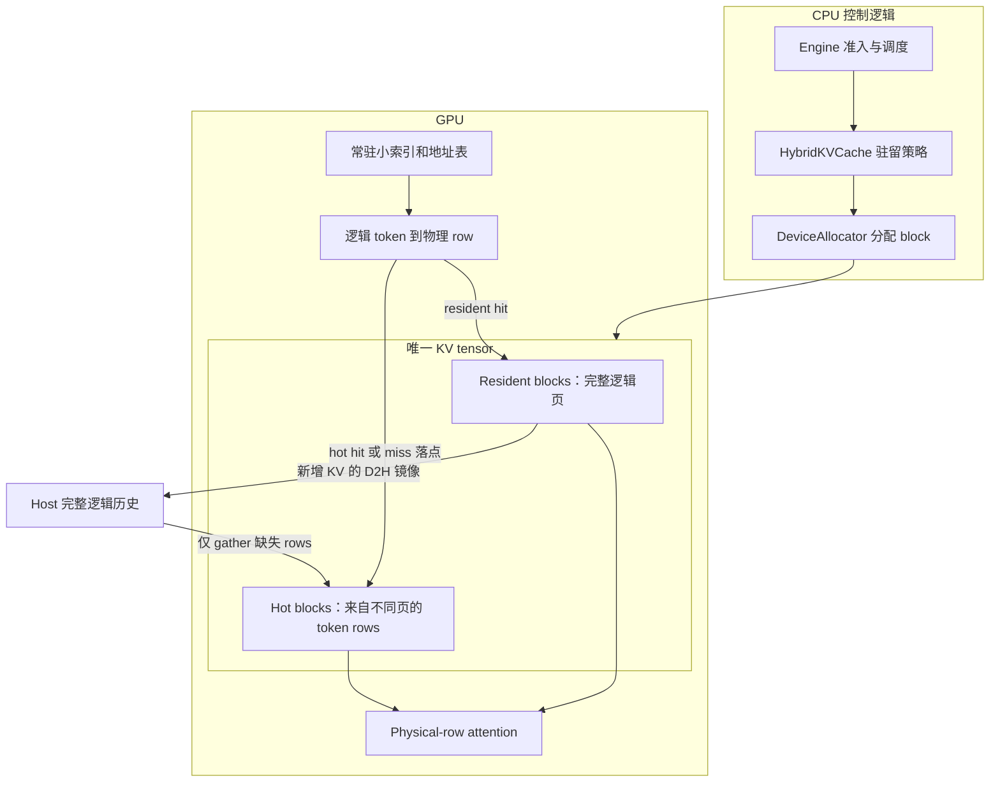
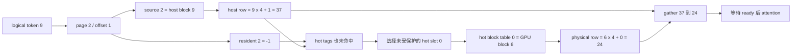
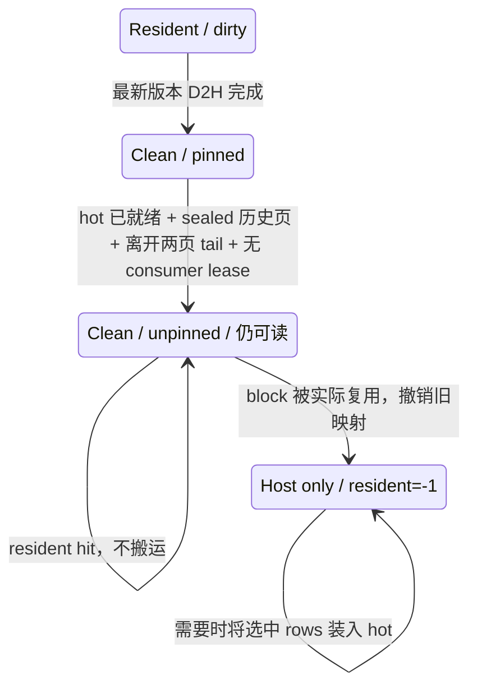
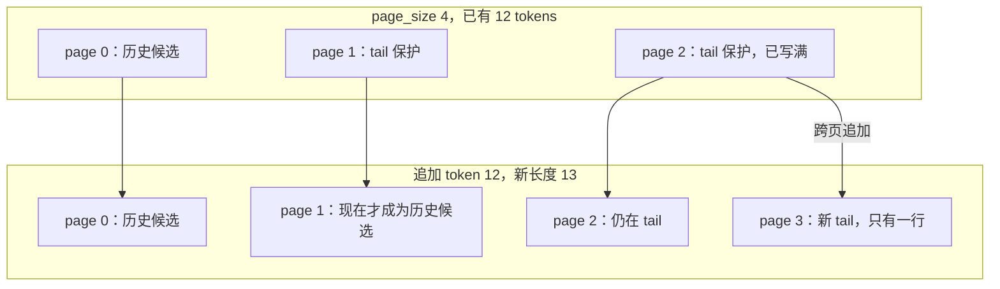
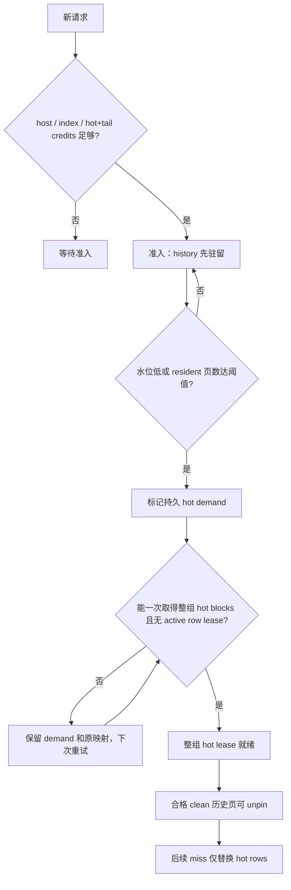
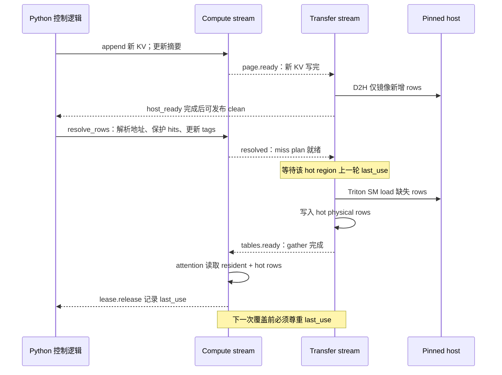

# 图解：部分 KV 驻留，为什么还能继续 decode？

[文档首页](README.md) · 下一步：[跟着代码走一轮 decode](code-walkthrough.md) · [运行例子](examples.md)

下面描述当前默认 `hybrid` 实现。先记住两个规则：**逻辑历史始终有 host backing；GPU 容量分配按 block，缺失数据搬运按 token row。** 图中的 host 镜像在对应 D2H 完成后才有效。

## 1. 一个 GPU 池，三种管理粒度



| 概念 | 举例 | 生命周期与用途 |
|---|---|---|
| 逻辑页 | `(request=A, layer=2, page=17)` | token 区间的身份；被逐出后仍存在 |
| GPU block | `block 6` | 唯一 tensor 的物理槽；可先给 resident，之后复用为 hot |
| KV row | token 69 的 K 和 V，包含全部 KV heads | top-k 选择与 miss 搬运单位 |
| hot slot | 某请求/层的 `slot 5` | hot region 内的行号；内容可按 LRU 替换 |

GPU 与 host 的布局均为 `[blocks, 2, page_size, kv_heads, head_dim]`。所谓 physical row 是寻址编码 `block * page_size + offset`，不是把整个五维 tensor 当二维数组做任意 view。kernel 会据此定位 K/V 两个平面。

**为什么分开？** 一个逻辑页可能只有两个 token 被选中，搬整页会浪费带宽；但底层按 block 分配可以保留简单的容量和所有权管理。对应代码：[allocator.py](../mini_hisparse/allocator.py)、[LayerTables](../mini_hisparse/hybrid.py)。

## 2. 用一组数字走完寻址

运行 `python examples/inspect_indices.py`。下面的表来自这个构造例子，调用的是真实 `resolve_rows()`；它只演示地址解析，不执行 KV gather。

设 `page_size=4`，有效 token 为 `0..15`：

| logical page | token 区间 | `source[page]`：host block | `resident[page]`：GPU block |
|---:|---|---:|---:|
| 0 | 0–3 | 5 | -1 |
| 1 | 4–7 | 2 | 7 |
| 2 | 8–11 | 9 | -1 |
| 3 | 12–15 | 4 | 3 |

Hot block table 是 `[6, 1]`，说明 8 个 hot slots 分散在 GPU block 6 和 1。`tags[5]=22` 表示 slot 5 缓存的是 **host physical row 22**，对应 logical token 2；其余 slots 为空。Hot LRU 中 slot 0 最旧。



输入 `[9, 2, 6, 9, 14, -1]` 的完整结果：

| 输入 | 分支 | 计算 | physical row |
|---:|---|---|---:|
| 9 | miss | host row 37 → hot slot 0 → GPU block 6, offset 0 | 24 |
| 2 | hot hit | host row 22 → slot 5 → GPU block 1, offset 1 | 5 |
| 6 | resident hit | GPU block 7, offset 2 | 30 |
| 9 | 重复输入 | 去重，避免重复 softmax 权重 | -1 |
| 14 | resident hit | GPU block 3, offset 2 | 14 |
| -1 | padding | 不参与 attention | -1 |

最终 counts 为 `resident=2, hot=1, miss=1`。Miss plan 是固定宽度数组，其有效前缀只有 `host=[37] → device=[24]`，剩余填 -1。[原始输出](reports/index-walkthrough.json)。

**关键顺序：先保护所有选中的 hot hits，再给 misses 分配 victims。** 即使 token 2 出现在一个 miss 后面，也不能在扫描早期被覆盖。替换发生在请求/层自己的 hot rows 内，不重新申请 GPU block。对应代码：[resolve_rows](../mini_hisparse/row_index.py)。

GQA 各 query head 可以选不同 token。`LogicalTopK.from_selection()` 先建立跨头 token 并集，再用 `head_columns` 还原各头 mask：同一 KV row 只搬一次，但各头仍只计算自己的选择。原生设备 top-k 可直接传 `LogicalTopK`；当前 Quest 适配会在 CPU 构造并集。

## 3. Clean page：可回收和已回收是两件事



“Clean”指 host 已拥有当前版本：`host_committed_version == content_version`。只提交 copy、或者页面已经写满，都不足以证明 clean。

`allocator.free` 放真正空 block，`allocator.reclaimable` 放仍有有效内容的 unpinned block。分配先取空 block；用完才考虑后者。真正复用时调用 `_on_block_reused()`，撤销旧 resident table，再绑定新 owner 并递增 generation。

| 生命周期例子：A 的 page 0 | GPU block 0 的 owner | generation | 读 A 的 token 0 |
|---|---|---:|---|
| clean pinned | A/page 0 | 1 | resident hit |
| unpin | A/page 0 | 1 | 仍为 resident hit |
| B 消耗其它空 blocks | A/page 0 | 1 | 仍为 resident hit |
| B/page 3 真正复用 block 0 | B/page 3 | 2 | A 转向 host → hot |

`python scripts/inspect_residency.py --device cpu` 实际构造了这个过程。它还校验 attention 输出，并在最后观察到一行 64 bytes 的 H2D；页面大小和 head 形状是专门缩小的演示配置。[验证说明](validation.md#clean-page-lifecycle)。

**为什么不在 unpin 时清映射？** 这样既让分配器可以回收容量，也保留了尚未被覆盖数据的命中机会。RowLease 会暂时阻止当前层 resident pages 被复用；CPU lease 释放后，GPU `last_use` 事件继续保护在途读取。

## 4. 为什么有两页 tail？

每层保护最后两个**逻辑页**，不是最后两个 token，也不是所有页中的任意两个 physical blocks。令当前尾页 index 为 `t`，候选历史页必须满足 `page_index <= t-2`，同时 sealed、clean、没有 consumer lease，且 hot 已具备接管条件。



跨页时，新页与刚写完的上一页都留在 GPU，避免紧邻追加路径的页立刻进入回收。保护页数与参考 vLLM snapshot 的 `ACTIVE_TAIL_PAGES=2` 对齐；本项目没有实现其全部调度时序。[具体对齐范围](residency-alignment.md)。

## 5. Hot 空间：先做准入承诺，再在压力下分配

令 `P=page_size`、`U=max_union_rows`、`H=hot_rows`、`L=层数`。默认 `H=2U`，并要求 `H>=U`：即使选中的 token 全部不在 resident，也有足够 slots 容纳本步并集。

```text
每层 hot blocks = ceil(H / P)
每请求准入 credit = L * (ceil(H / P) + 2)
每 block 字节数 = 2 * P * kv_heads * head_dim * dtype_bytes
```

例如 tiny demo 中 `L=2, P=16, U=32, H=64`：每层 4 hot blocks + 2 tails，每请求至少 12 blocks。准入预留的是**容量 credit**，并非开始就把 8 个 hot blocks 从池里拿走；未用 credit 可被 resident history 借用。



常规触发有两个，另外还存在 `_slot()` 的容量压力兜底和显式诊断触发：

| 触发 | 默认/条件 | 含义 |
|---|---|---|
| 水位 | 可分配 blocks `< max(每层 hot blocks, 总 blocks // 10)` | 追加申请前按 `available-1` 预测，不等完全耗尽 |
| resident window | 该层 resident 页数 `>=64` | 限制持续借用空间的时长；可配置，不是 attention window |

整组分配时如果空闲不足，可在预检全部通过后，用**本层合格的 clean 历史页**原子地补足 hot blocks。不能先无条件清空历史，再发现 hot 不够。正常 update 只查询 D2H 事件；同步 prefill 完全耗尽容量时，才可能等待一个有用的镜像完成事件。

Hot lease 持续到请求结束；row tags/LRU 则每步变化。这里没有全局自适应 hot 缩容或跨请求借 slot 策略。对应代码：`reserve()`、`update_residency()`、`transition_to_host()`、`_slot()`，都在 [hybrid.py](../mini_hisparse/hybrid.py)。

## 6. 读写时序：地址准备好，不代表内容准备好



图中的“记录事件”和“事件已完成”不同。Python 可以先返回，GPU 工作还在执行。Host backing 和索引表在 request finish/cancel 后进入 retirement 生命周期，直到事件完成才可复用。

单一 transfer stream 保证 D2H mirror 在后续 host gather 前完成；gather 通过 pinned host 的 CUDA 地址由 SM 读取，不是 DMA copy engine。多 stream 建立了异步依赖，**不直接证明存在性能收益或有效 overlap**；当前也没有共享 index 的跨层预取。

对应代码：[HostStore.append](../mini_hisparse/storage.py)、[HybridKVCache.resolve / RowLease](../mini_hisparse/hybrid.py)、[gather_rows / attend_rows](../mini_hisparse/row_kernels.py)。

## 7. 如何判断这个设计是否有效？

先分别验证三个问题：

1. **数据是否正确？** 同一个 selection，hybrid 输出应与直接读完整 K/V 的 oracle 一致，允许对应 dtype 的数值误差。
2. **是否能持续前进？** 部分页被回收后继续 decode，`prefill_count=1`；不能用反复 prefill 掩盖缺页。
3. **是否值得这么做？** 同容量、同 trace 比 H2D bytes 和耗时，同时展示 hot 预留空间及索引成本。

整页选择不一定适合 row cache，少搬数据也不必然更快。下一步看 [代码调用链](code-walkthrough.md)，或者直接跑 [三个使用例子](examples.md)，最后看 [当前 baseline 对比](benchmarks.md)。
